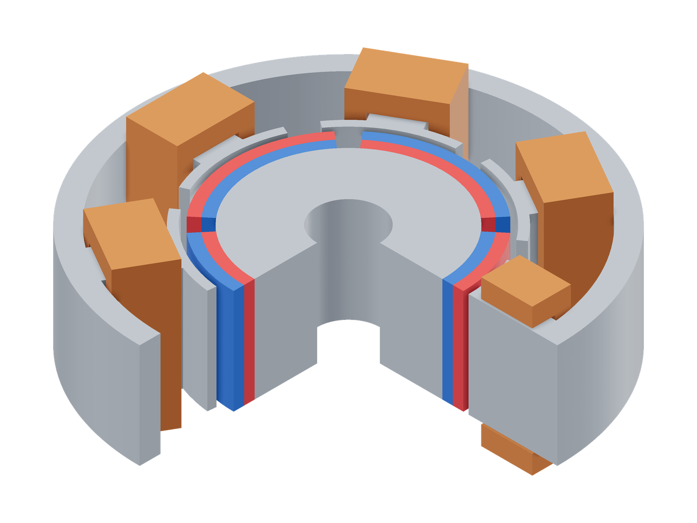
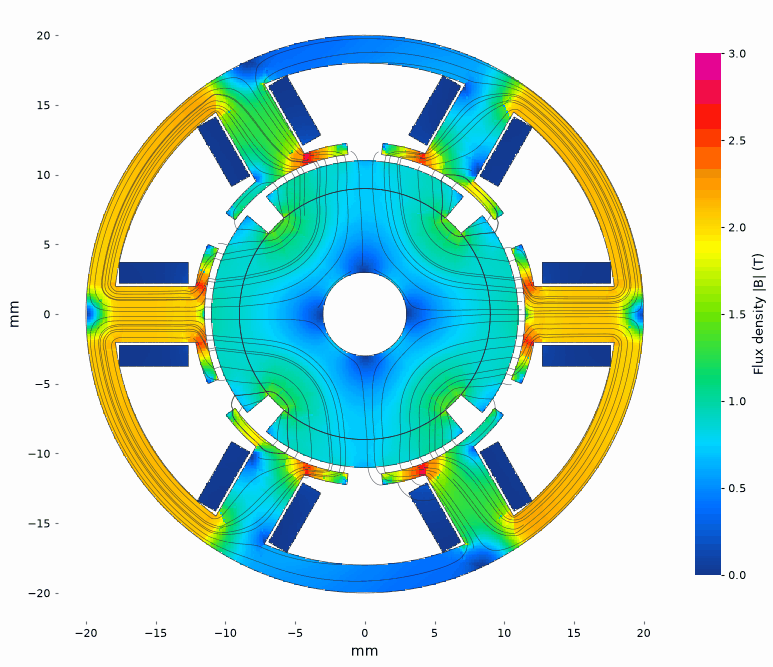

# step2torque

GPU-accelerated nonlinear 3D FEM solver to get motor torque from a STEP assembly. Simple python interface makes it easy to automate evaluation of your custom motors with arbitrary geometry.

[Open the browser viewer](https://qwertpas.github.io/step2torque/)

| Model | Flux density |
|---|---|
|  |  |

Install:
```sh
python3 -m pip install step2torque
```

Solve using your own .step file:
```python
from step2torque import Motor

motor = Motor("motor.step")
print(motor.components)  # CAD component names
motor.components["stator"].set_material("1J22")
motor.components["coil"].make_coil(phase=1, turns=72, direction="+z")
motor.components["magnet"].make_magnet(direction="radial", br=1.2)

sol = motor.solve(power=5.5)  # returns immediately; optimizes currents
print(sol.status, sol.progress)
sol.wait()                  # optional blocking wait
print(sol.torque, sol.currents)  # N·m, instantaneous phase A
print(sol.flux_density([[0, 0, 0]]))  # B in tesla, points in CAD mm
```

Render and share the solved field:

```python
from step2torque import Plane
sol.render_image("field.png", plane=Plane.axial(z=0))
sol.render_html("motor.html")
sol.export("motor.s2t")
```

Open the HTML directly, or load the `.s2t` file in the browser viewer.

---

### Specifying parameters
- Coils are circular or rectangular annuli; direction is their right-hand axis. Specify turns or resistance; the other parameter is calculated using CAD dimensions, 60% copper fill and 20°C.
- Multiphase currents sum to zero by default; `balanced=False` permits independent phase drives. Coils sharing a phase are in series; resistance is per coil.
- Magnets accept a global vector, `"radial"`, or `"-radial"`. For a multipole ring, use `make_magnet(direction="radial", poles=20)`; `offset=5` shifts its pole pattern by 5 mechanical degrees.
- Rotor-named components and magnets can be rotated. `Motor(..., axis="+z", center=(0,0,0))` changes the shaft axis and center in mm.
- `motor.solve(angle=10, current={1: 2.0})` rotates moving parts 10 mechanical degrees from the STEP and uses fixed current. Use `current={}` to get cogging (torque at zero current).
- Separate touching iron parts use a 10 µm surface contact. `Motor(..., contact_gap=0.01)` sets this gap in mm; use zero for perfect magnetic contact.
- Other components default to steel.
- Before solving, you may use `motor.render_image("setup.png")`, `motor.render_html("setup.html")` or `motor.export("setup.s2t")` to check the geometry, phase labels and winding direction. Preview currents default to 1 A per phase; pass `current={1: 2.0}` and `angle=10` to set their initial values.


GPU acceleration is included. `python3 -m pip install 'step2torque[cuda]'` enables NVIDIA
cuDSS; `device="auto"` selects an available device. Optional solve arguments:
`threads=8`, `mesh_size=0.6` (surface mm).

[Examples, benchmarks and commercial case studies](examples/README.md)

