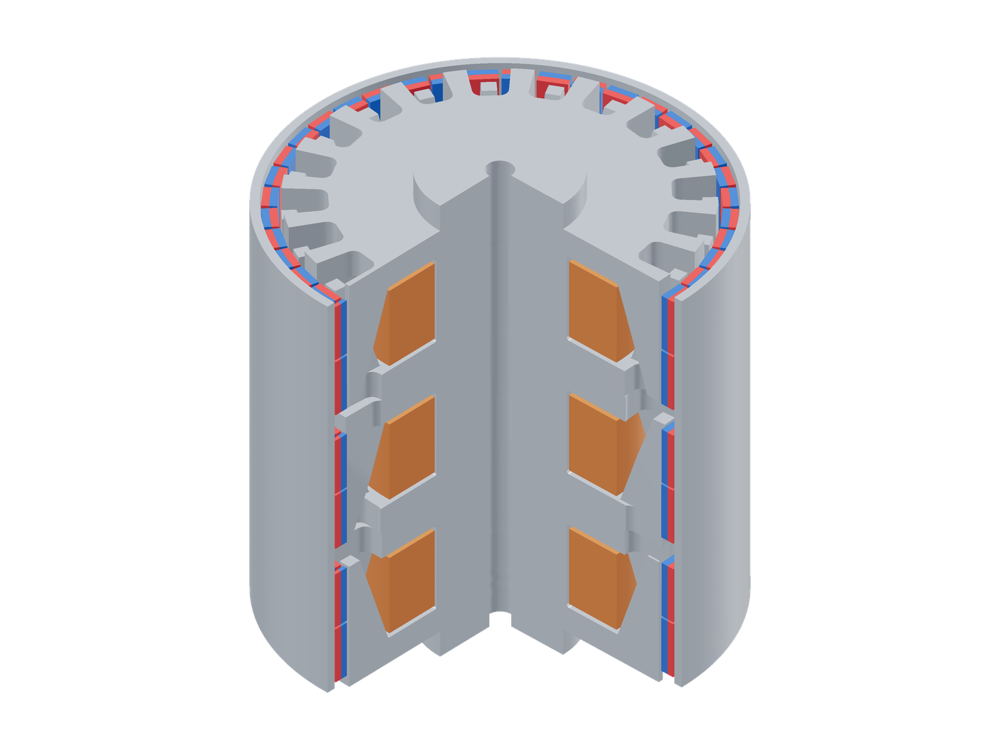
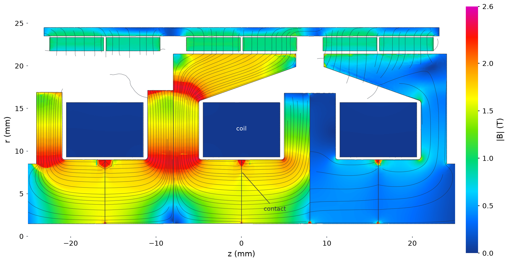
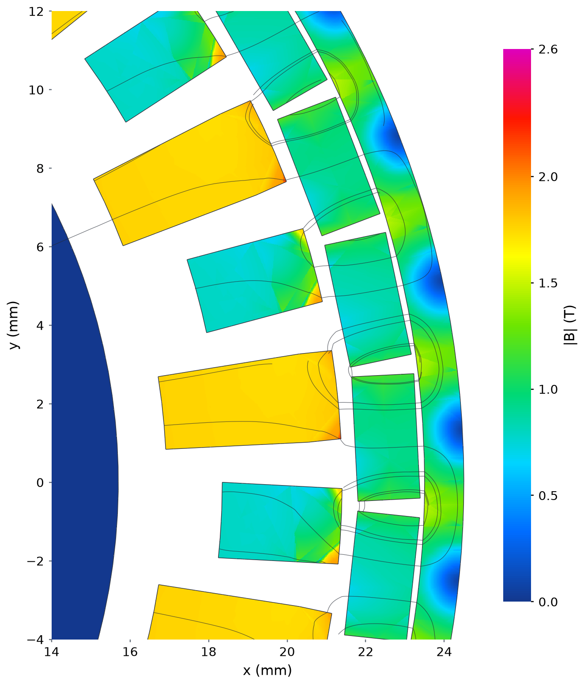

# Transverse-flux regression

| Model (quarter cutaway) | Flux density and paths |
|---|---|
|  |  |

Model magnets: red N, blue S.

Saved reference at 73.125° electrical. This longitudinal half-section exposes
the three coil windows, loaded claw root and axial cup return. Colour: total
|B|, 0–2.6 T; curves: its in-plane projection. Mating iron pieces use 10 µm
surface contacts; the reference torque is 2.154059 N·m.

The axial cut adds circumferential gap crossings and the outer rotor return,
on the same colour and physical line scales. The apparent separate teeth
connect through the axial cups; a single planar view cannot show both routes.

This illustrates a private regression fixture. Its raw mesh and saved fields
are not distributed with the public examples.
