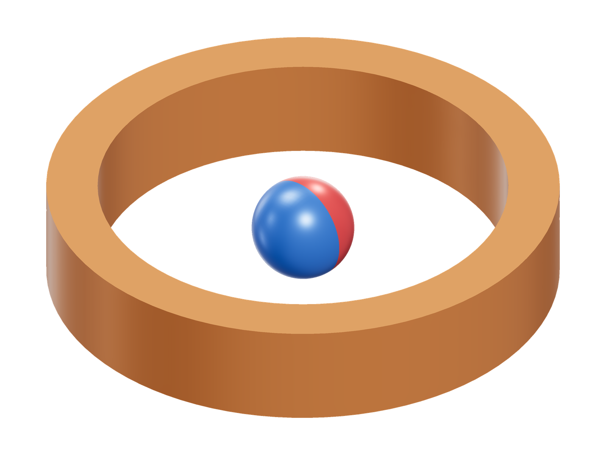
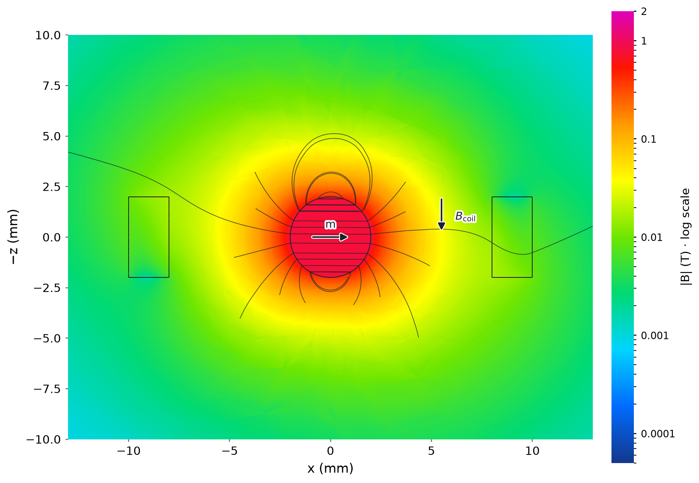
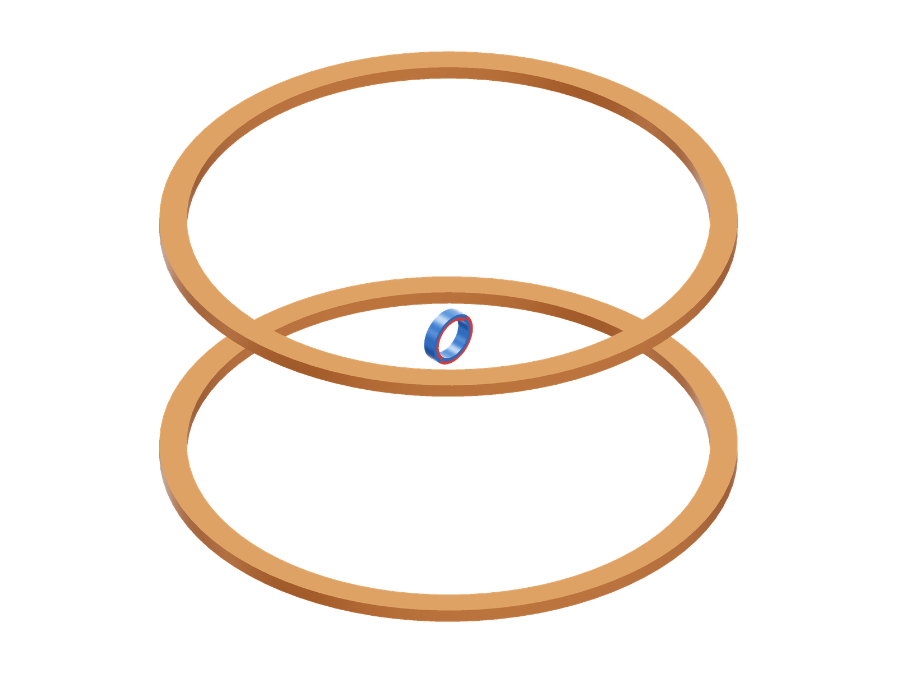
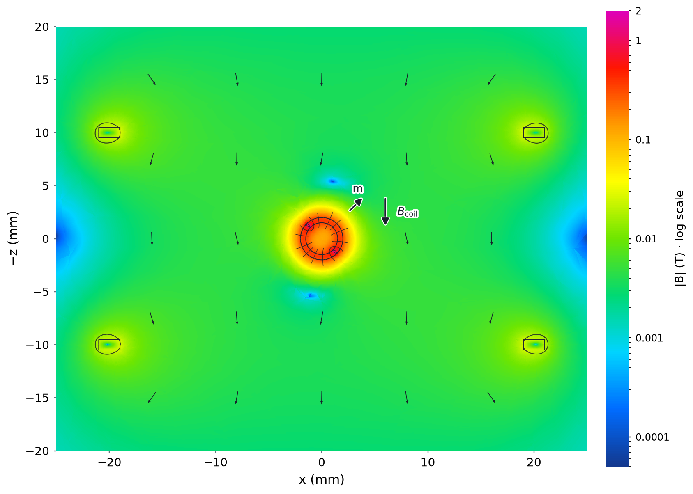
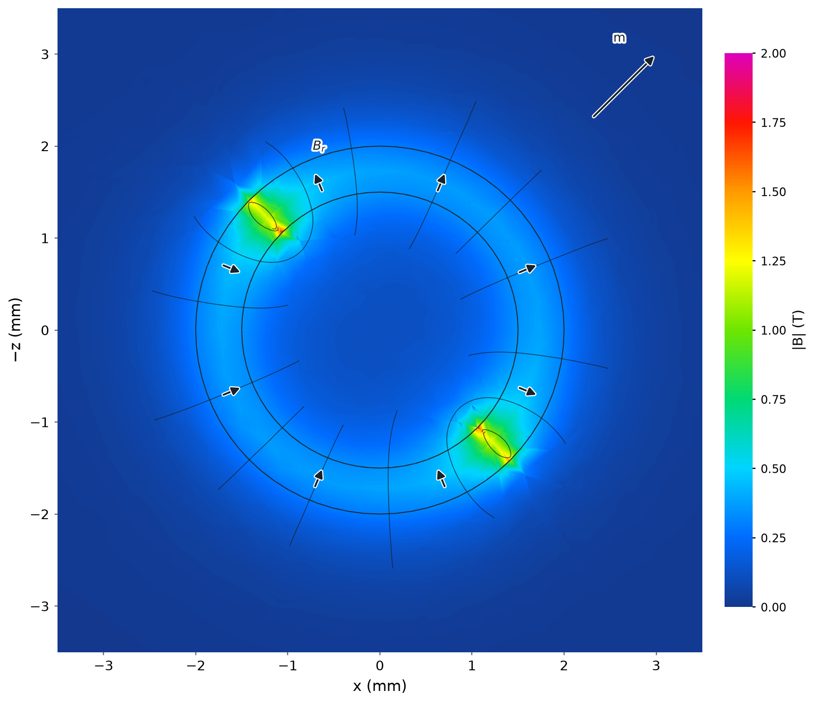

# Analytic magnet torque

| Sphere and winding | Flux density and paths |
|---|---|
| [](sphere-model-3d.png) | [](sphere.png) |

Model magnets: red N, blue S.

A permanent-magnet sphere in a 1 A annular coil. The moment **m** is perpendicular
to the applied coil field. Logarithmic colour shows total |B|; curves trace its
in-plane component, including the dipole return paths.

| Ring and windings | Flux density and paths |
|---|---|
| [](ring-model-3d.png) | [](ring.png) |



The rotated two-pole ring, enlarged on a linear 0–2 T scale. Short arrows show
remanence **Br**; **m** is the net moment. The bore and concentrations at the
remanence reversals are visible. The coil context above uses logarithmic colour
and direction-only air arrows; its colours are not comparable to this detail.


```sh
python3 examples/benchmarks/analytic/run.py
```

## Sources

Original idealized models: [sphere.step](sphere.step) and [ring.step](ring.step).
References use the [magnetic dipole torque law](https://www.feynmanlectures.caltech.edu/II_15.html#Ch15-S1)
with Biot–Savart integration over the coil winding packs.

## Assumptions

The sphere has radius 2 mm, remanence 1.2 T and relative permeability 1.05.
Its 50-turn coil has radii 8–10 mm and height 4 mm. The shaft is along +y,
the coil along +z, and the initial magnetization along +x. The sphere's effective
moment is `3 Br V / (mu0 (mur + 2))`; torque is `m × B`.

The second model has a two-pole ring with radii 1.5–2 mm and length 1 mm,
between two 100-turn coils at z = ±10 mm. Coil radii are 19–21 mm, height 1 mm.
The magnet uses Br = 1.2 T and relative permeability 1. Its integrated moment
is `2 Br V / (pi mu0)`. A 15° pole offset and 30° mechanical rotation exercise
both angle settings. The reference uses the field at the small rotor's center.

## Results

| Sphere mesh, mm | Angle | Reference, N·m | Simulated, N·m | Difference |
|---:|---:|---:|---:|---:|
| 1.00 | 0° | -0.000107647 | -0.000107104 | -0.504% |
| 0.60 | 0° | -0.000107647 | -0.000107031 | -0.573% |
| 0.25 | 0° | -0.000107647 | -0.000107078 | -0.529% |
| 0.35 | 60° | -0.0000538234 | -0.0000534019 | -0.783% |
| 0.35 | 90° | 0 | 0.0000000324 | 0.0301% of peak |

| Ring mesh, mm | Reference, N·m | Simulated, N·m | Difference |
|---:|---:|---:|---:|
| 0.60 | -0.00001062348 | -0.00001062056 | -0.0275% |
