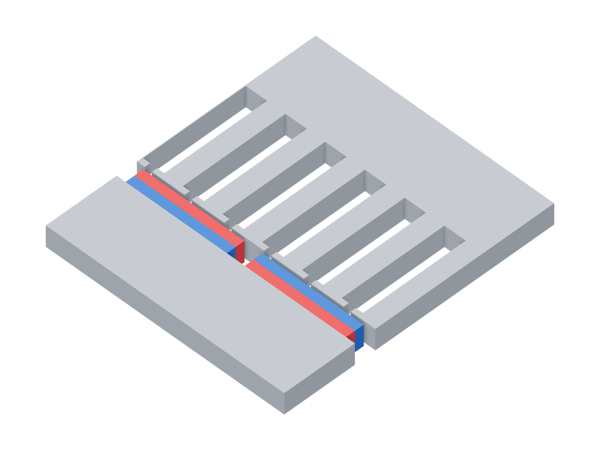
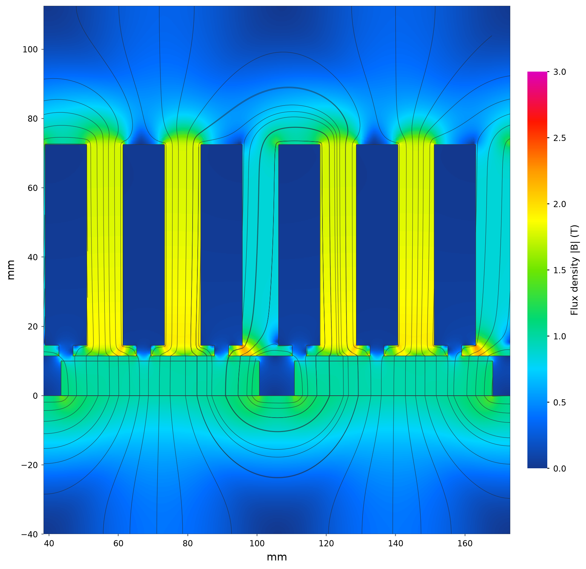
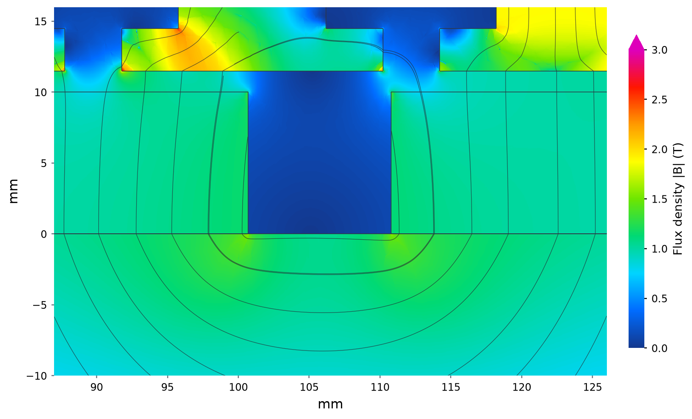

# Unrolled axial-flux motor

| Unrolled model | Flux density and paths |
|---|---|
| [](model-3d.png) | [](field.png) |

Model magnets: red N, blue S.

The model view enlarges the 0.5 mm dummy depth to 12 mm for visibility.
Two opposite half-periods of the corrected 3D model are shown in the field. Colour: total |B|, 0–3 T;
curves: projected B. The section lies halfway through the 0.5 mm periodic dummy
depth; it is an unrolled flux plane, rather than a full annulus.



The 1.5 mm axial gap, PM edges and tooth lips are resolved on the same colour
and physical line scales. The upper colourbar triangle marks values above 3 T.
Local corner and interface values remain sensitive to the retained mesh.

Boundary labels are assigned to every boundary face in the included script.
The figures use that corrected setup.


```sh
python3 examples/benchmarks/axial/run.py
```

## Sources

[Nyitrai and Orosz, 2021](https://www.pp.bme.hu/eecs/article/view/17755)
and the [released Ārtap model](https://raw.githubusercontent.com/artap-framework/artap/96f4484f448649dc2a8aa9772c03f39f2cb62372/examples/EM_optimization_with_FEMM/AF_AntiPeriodic.fem).
The matched FEMM input is included as [model.fem](model.fem).

## Assumptions

Open-circuit, unrolled motor with M-27 steel at 98% stack and N38 magnets.
Two opposite poles form one periodic repeat. The horizontal outer boundaries
use `Bt=0` in both solvers, replacing the original model's `Bn=0` boundaries.
An axial periodic extrusion preserves the 2D approximation; finite annular end
effects are outside this benchmark.

## Results

| Quantity | Refined FEMM | step2torque | Difference |
|---|---:|---:|---:|
| Cogging force, N | 152.7754 | 151.9467 | -0.542% |

The reference is our independent xfemm weighted-stress solve of the matched
model: 0.175 mm bulk mesh, 0.025 mm gap mesh, 982,825 triangles. The preceding
refinement gave 153.1197 N, a 0.225% change. The reference value is not quoted
from the paper. Add `--cpu` to select the CPU explicitly.
