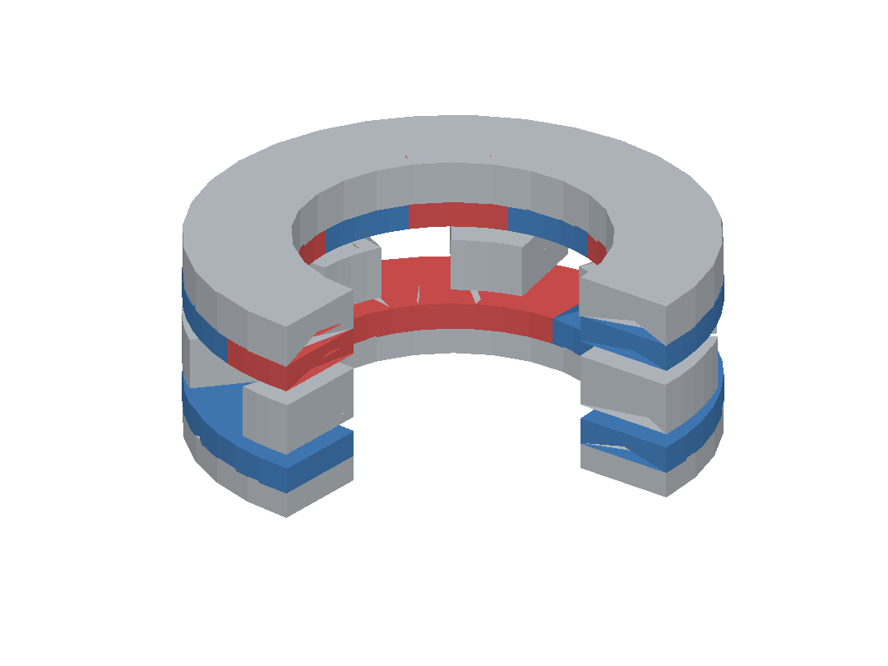
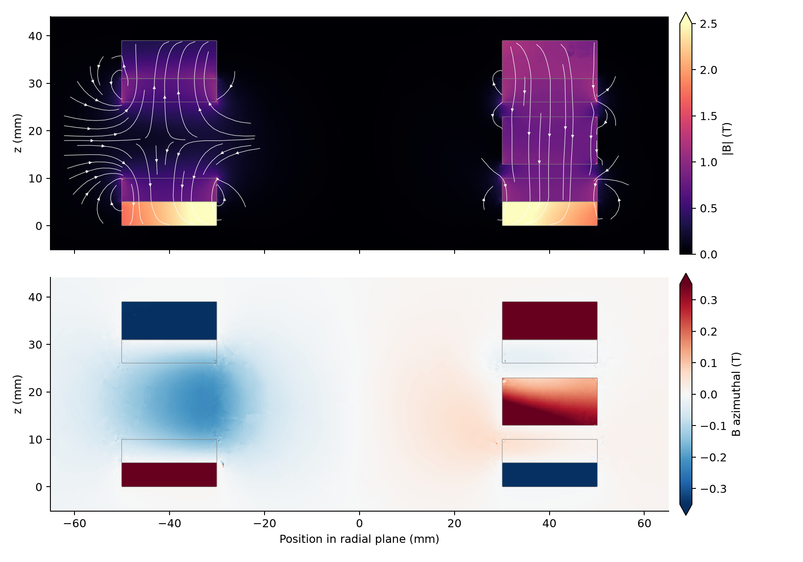
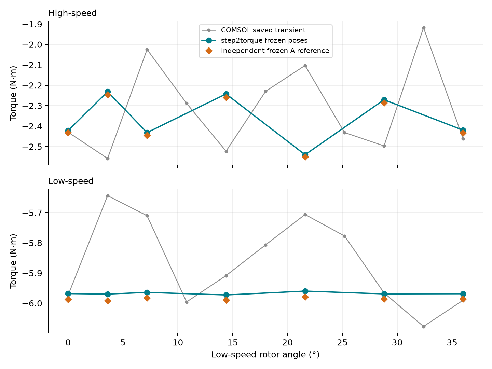

# Axial-field magnetic gear

| Model (quarter cutaway) | 3D flux density and paths |
|---|---|
| [](model-3d.png) | [](field.png) |

Grey: steel. Red / blue: +z / −z magnetization. Field at the supplied initial
pose: total |B| above, azimuthal B below; curves are projected flux paths.
Finite annuli, two axial gaps and end fringing require a full 3D field.



```sh
python3 examples/benchmarks/gear/run.py
```

Seven frozen poses; each rotor's torque is measured separately on the same
equilibrium. Add `--initial` for one pose or `--cpu` for CPU. The script prints
its output folder and checks both torques against the stored 3D reference.

## Source and setup

[COMSOL application 22301](https://www.comsol.com/model/axial-field-magnetic-gear-in-3d-22301)
and its [original model](https://www.comsol.com/model/download/1484721/axial_field_magnetic_gear_3d.mph).
The reconstructed assembly is included as [gear.step](gear.step).

All solids occupy r = 30–50 mm; the gaps are 3 mm each.

| Part | z, mm | Material law |
|---|---:|---|
| High-speed yoke | 0–5 | μr = 500 |
| Four high-speed magnets | 5–10 | Br = 1.42 T, μr = 1.05 |
| Seven stationary sectors | 13–23 | μr = 1000 |
| Ten low-speed magnets | 26–31 | Br = 1.42 T, μr = 1.05 |
| Low-speed yoke | 31–39 | Native [B–H curve](bh.csv), linear interpolation and extrapolation |

Both magnet arrays start with −z at +x and alternate. Stationary sectors start
at 360k/7° and span 360/14°. Poses follow θHS = −2.5θLS, without a fitted offset.
The original insulated air cylinder is retained: R = 75 mm, z = −20…59 mm.
No winding currents or parameter fitting.

## Results

Initial pose, signed torque about +z:

| Rotor | COMSOL saved, N·m | Frozen 3D reference, N·m | step2torque, N·m |
|---|---:|---:|---:|
| High-speed | −2.42973 | −2.43105 | −2.42211 |
| Low-speed | −5.97369 | −5.98733 | −5.96833 |

Across seven poses, the maximum difference from the independent frozen reference
is **0.773% / 0.367%** (high / low speed). It uses a vector potential and
Maxwell stress, sharing the same CAD, material laws and NGSolve. COMSOL's saved
transient has different ripple, with differences up to 20.8% / 5.78%; its cause
remains unresolved.

Last refinements change torque by 0.081% (gap), 0.155% (body), 0.085% (enlarged
air domain) and 0.546% (independent reference). B–H subdivision changes torque
by less than 10⁻¹² N·m. The primary comparison retains the original air boundary
and uses a 1% tolerance. [Values and convergence data](results.json).

The script uses the package's field, motion and torque routines with a custom
mesh to retain the source boundary and two independently prescribed angles.
To recompute the independent reference for a saved pose:

```sh
python3 examples/benchmarks/gear/reference.py /path/to/output/initial-gap
```
