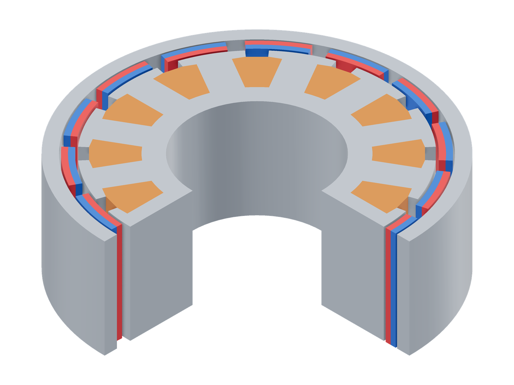
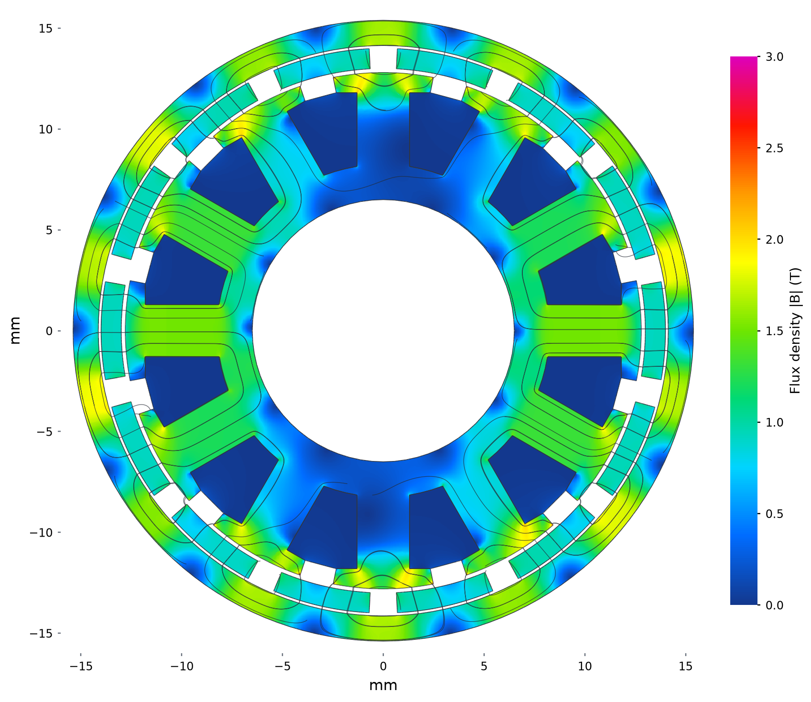
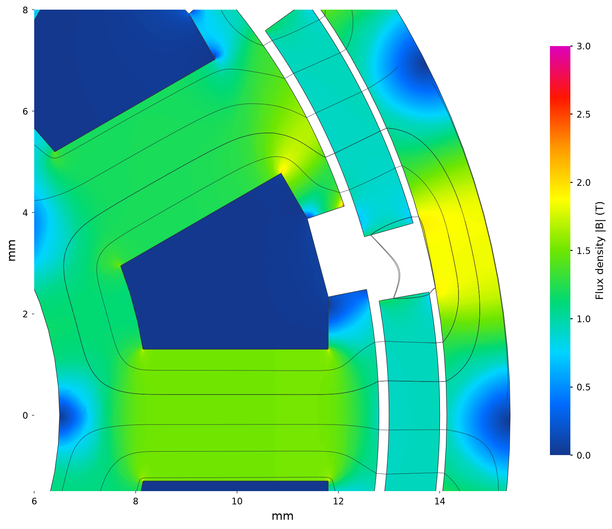

# FEMM LRK motor

| Model (quarter cutaway) | Flux density and paths |
|---|---|
| [](model-3d.png) | [](field.png) |

Model magnets: red N, blue S.

Model shown with the reference’s 10 mm stack; the field uses the artificial
0.1 mm periodic depth. Retained 3D scalar field at the midpoint of the artificial axial period, with
A/B/C = 0/+4/−4 A. Colour: total |B|, 0–3 T; curves: in-plane B. This illustrates
the axially periodic model, rather than a finite-length motor or a separate
published FEMM field.



The detail separates the 0.20 mm working gap from the 0.14 mm air layer behind
the magnets. It preserves the full view's colour scale and physical line spacing.
Isolated tooth-corner peaks are sensitive to the retained mesh.


```sh
python3 examples/benchmarks/lrk/run.py
```

## Sources

[FEMM Sliding Band Benchmark](https://www.femm.info/doku/doku.php?id=SlidingBandBenchmark)
publishes the whole-motor model and weighted-stress torque in Table 1.
The released input is included as [model.fem](model.fem).

## Assumptions

The 2D motor is extruded with axial periodic boundaries and torque scaled to
the published 10 mm depth. Geometry, nonlinear steel, magnet properties and
winding currents follow the released model. Slot currents are imposed through
edge circulations. Finite motor ends are outside this benchmark.
The outer FEMM `A=0` condition is matched by the scalar form's natural zero
normal-flux boundary. One potential value fixes its arbitrary additive constant.

## Results

| Quantity | FEMM reference | step2torque | Difference |
|---|---:|---:|---:|
| Torque, N·m | 0.0554274 | 0.0552582 | -0.305% |

The solve uses 329,502 tetrahedra and 660,372 degrees of freedom.
Add `--cpu` to select the CPU explicitly.
