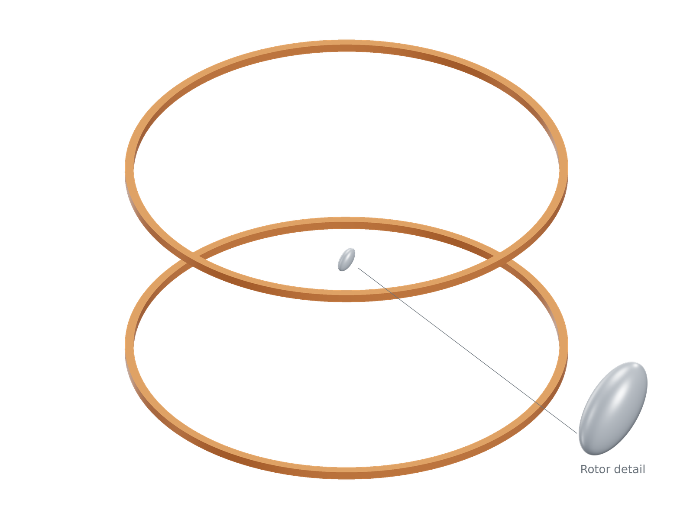
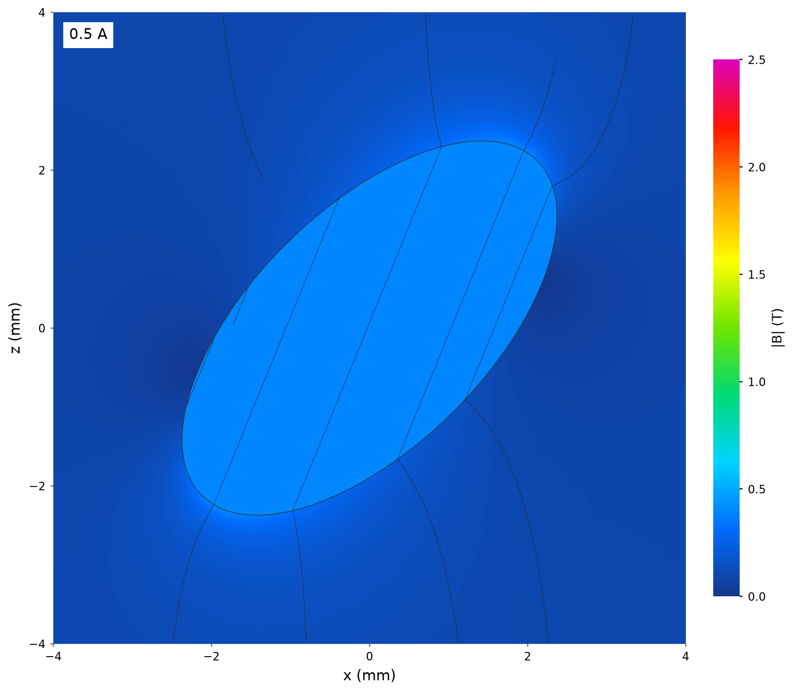
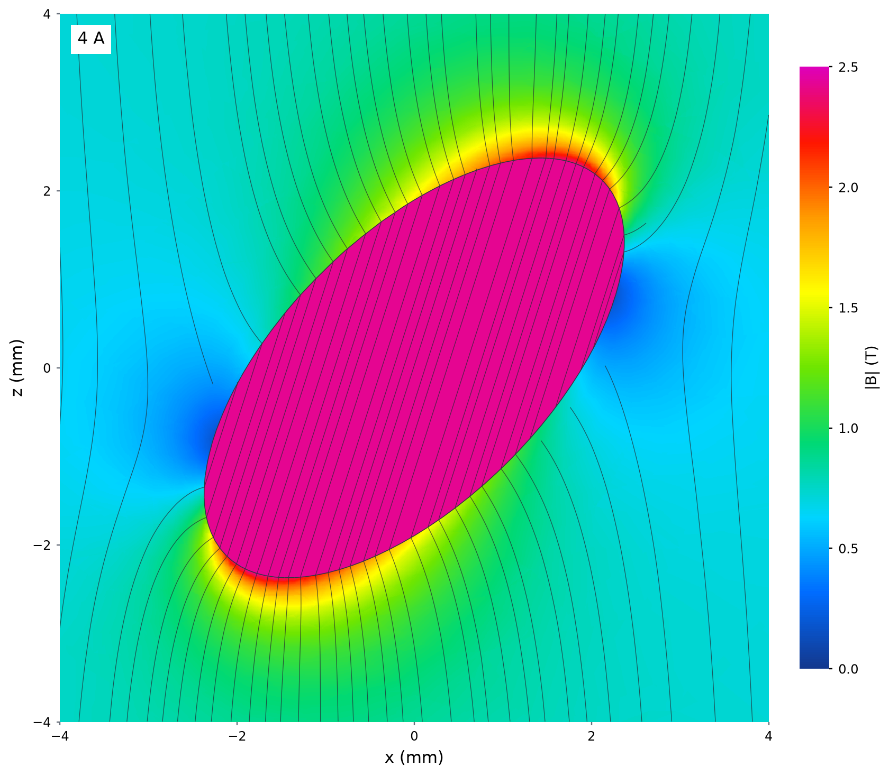

# Nonlinear reluctance torque

| Model | 0.5 A | 4 A |
|---|---|---|
| [](model-3d.png) | [](low.png) | [](high.png) |

A 6 × 3 × 3 mm 1J22 ellipsoid at 45° to the vertical Helmholtz field. Both views
use the same crop, 0–2.5 T scale and physical line spacing. Induction rises from
about 0.398 T to 2.425 T; the high-current polarization reaches the saved curve's
plateau. The tighter specimen view makes saturation and end crowding visible.


```sh
python3 examples/benchmarks/reluctance/run.py
```

## Sources

Original [motor.step](motor.step); [Osborn's ellipsoid demagnetization solution](https://doi.org/10.1103/PhysRev.67.351);
[Kede 1J22 material data](https://www.kedemagnetics.com/download/datasheet-of-soft-magnetic-materials-at-room-temperature.pdf).

## Assumptions

A prolate 1J22 rotor has semi-axes 3 × 1.5 × 1.5 mm and is rotated 45° about +y.
Two 10,000-turn coils at z = ±25 mm have radii 49–51 mm and height 2 mm.
Their field is nearly uniform across the small rotor. The reference solves
`H_internal + N M(H_internal) = H_external` with the full nonlinear B–H curve,
then evaluates `V M × B_external`. Mesh size is 0.6 mm; air radius is 408 mm.

## Results

| Current, A | Reference, N·m | Simulated, N·m | Difference |
|---:|---:|---:|---:|
| 0.5 | -0.000303190 | -0.000304392 | +0.396% |
| 1.5 | -0.00272871 | -0.00273952 | +0.396% |
| 4.0 | -0.0110251 | -0.0110488 | +0.214% |

The 4 A case exercises magnetic saturation.
