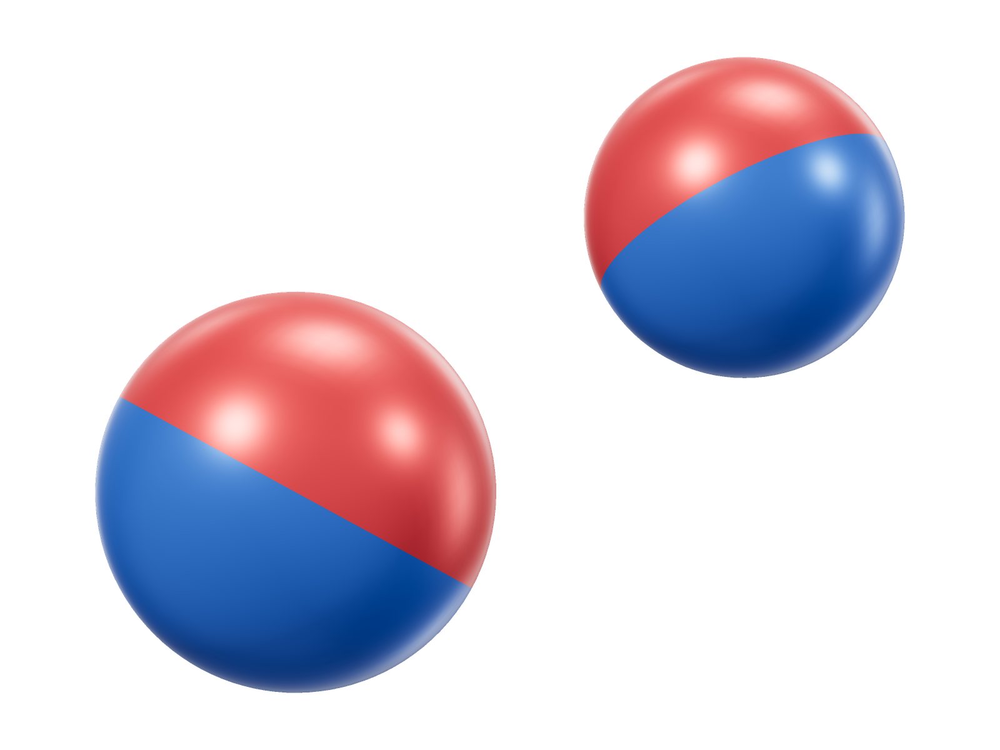
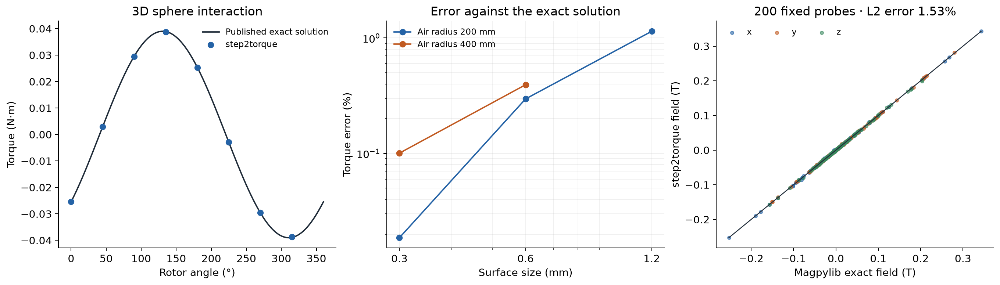

# Exact 3D sphere interaction

| CAD | Comparison |
|---|---|
| [](model-3d.png) | [](validation.png) |

```sh
python3 examples/benchmarks/spheres/run.py
```

## Sources

Edwards et al., [*Interactions between uniformly magnetized
spheres*](https://digitalcommons.usu.edu/physics_facpub/2033/), equations (1)
and (14): exact fields and torque for finite, nonoverlapping, uniformly
magnetized spheres. Reference values were evaluated with
[Magpylib](https://magpylib.readthedocs.io/en/stable/_pages/user_guide/examples/examples_force_intro.html).

[CAD](model.step) · [Reference values](reference.json) ·
[Field probes](reference-fields.npz) · [Results](comparison.csv)

## Setup

The source sphere has radius 10 mm, center (0, 0, 0) mm and polarization
1.2(1, 2, 3)/√14 T. The target has radius 8 mm, center (20, 10, 15) mm and
polarization 0.9(−2, 1, 2)/3 T. Both use μr = 1. Offset centers and nonparallel
magnetizations remove 2D symmetry. Torque is about the target's center.

The exact torque is **m × B**, using the source field at the target center.
The target moment is its volume times polarization divided by μ0.
The default run uses a 0.3 mm surface mesh and 400 mm air radius.

## Results

| Quantity | Reference | Simulated | Difference |
|---|---:|---:|---:|
| Torque about +z at 0°, N·m | -0.02542826 | -0.02540269 | -0.101% in magnitude |
| Field at 200 air probes | Exact sphere fields | Sampled FEM field | 1.53% relative L2 error |

**Solve time: 2 min 24 s**, GPU, 4 CPU threads, AMD EPYC 7J13 / NVIDIA A100 40 GB.
Torque differences compare magnitudes; field error is `‖B − Bref‖₂ / ‖Bref‖₂`
over 200 fixed air probes, with a 2 mm buffer around each sphere.

The eight-angle sweep at 0.6 mm mesh size and 200 mm air radius has maximum
absolute error **0.356% of peak reference torque**. The [results CSV](comparison.csv)
includes all 14 angle, axis, mesh and air-domain checks. At 0.3 mm, the smaller
200 mm air domain gives 0.0186% error; the headline uses the larger domain.
