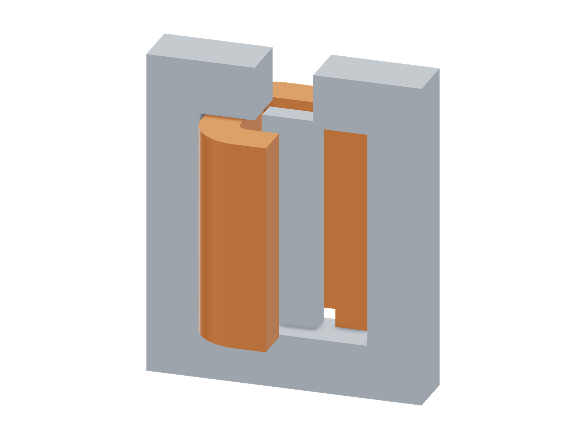
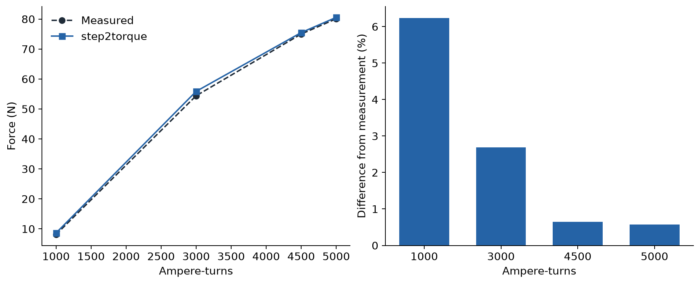

# TEAM 20 3D static force

| CAD | Comparison |
|---|---|
| [](model-3d.png) | [](validation.png) |

```sh
python3 examples/benchmarks/team20/run.py
```

## Sources

Nakata et al., *Improvement of measurement of 3-D static force problem
(Problem 20)* (1993), cited as reference [8] in the authors'
[*Summary of Results for Problem 20*](https://www.integratedsoft.com/documents/tech_3ax.pdf#page=2).

Geometry: [official TEAM definition](https://www.compumag.org/wp/wp-content/uploads/2018/06/problem20.pdf).
Measurements: [published force table](https://www.simscale.com/docs/validation-cases/team-20-magnetostatics/).
Steel curve: `BfuncH.k` from the
[LS-DYNA example](https://lsdyna.ansys.com/wp-content/uploads/2022/12/EM_example_TEAM20.zip).

[CAD](model.step) · [Measurements](measurements.csv) ·
[Steel curve](steel.csv) · [Results](comparison.csv)

## Setup

A 381-turn rounded square winding excites a finite steel pole inside a steel
yoke. The pole is 10 mm deep and the yoke 25 mm deep, giving true 3D fringing
fields and nonlinear saturation. Geometry follows the official nominal pole
position, z = 26.5–125 mm. The CAD image removes one quarter of the winding
to expose the pole; the solve uses the complete winding.

The measured quantity is vertical force. The native torque operator is
evaluated about +y through (100, 0, 75) mm. Reflection symmetry in x makes
the pole's intrinsic y torque and x force zero, so **Fz = Ty / 0.1 m**.
Reported forces are magnitudes.

The rounded winding uses a local input adapter with 64-point quadrature.
Field solving and torque evaluation use the native solver.
Mesh size is 2 mm; air radius is 400 mm.

The steel table includes LS-DYNA's two extra high-field samples, with μ0
extrapolation beyond the last point. The pole uses the official nominal
position rather than the LS-DYNA mesh's 0.1 mm upward shift.

## Results

| Ampere-turns | Measured, N | Simulated, N | Difference | Solve time |
|---:|---:|---:|---:|---:|
| 1000 | 8.1 | 8.6054 | +6.24% | 4 min 24 s |
| 3000 | 54.4 | 55.8641 | +2.69% | 2 min 14 s |
| 4500 | 75.0 | 75.4858 | +0.65% | 2 min 9 s |
| 5000 | 80.1 | 80.5628 | +0.58% | 2 min 3 s |

Differences use `100 × (simulated force magnitude / measured force − 1)`.
Times use GPU and 4 CPU threads on an AMD EPYC 7J13 / NVIDIA A100 40 GB.
The initial solve includes meshing, winding-source construction and torque
assembly; subsequent currents reuse those quantities and solve a fresh field.

Only one mesh resolution has been evaluated. The largest difference is +6.24%
at the lowest current.
