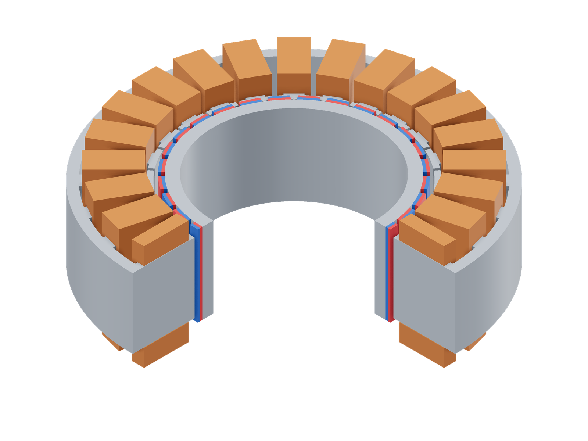
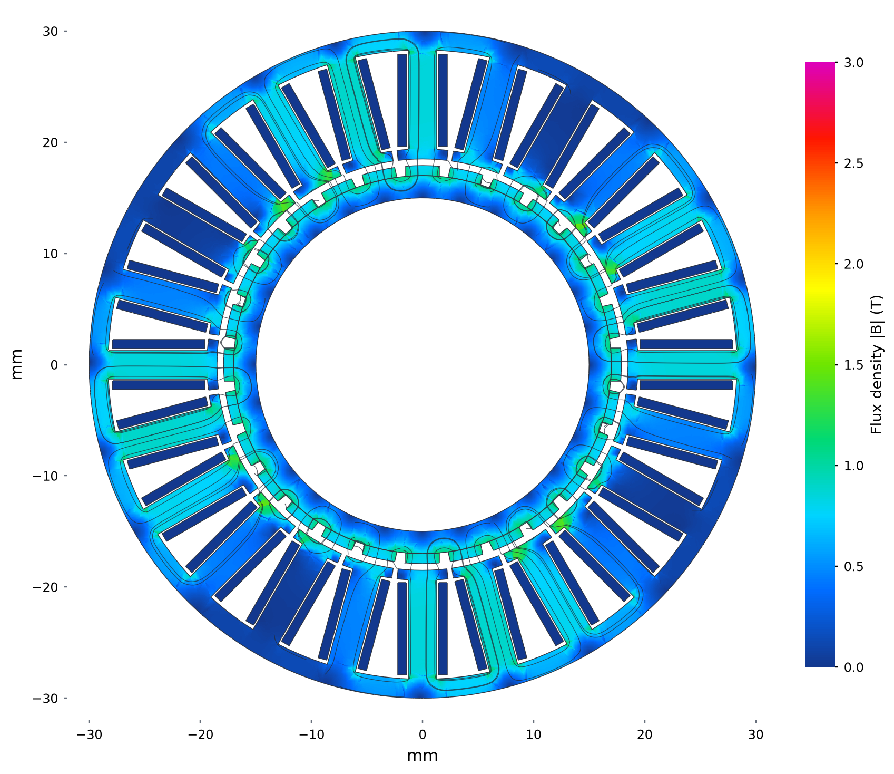
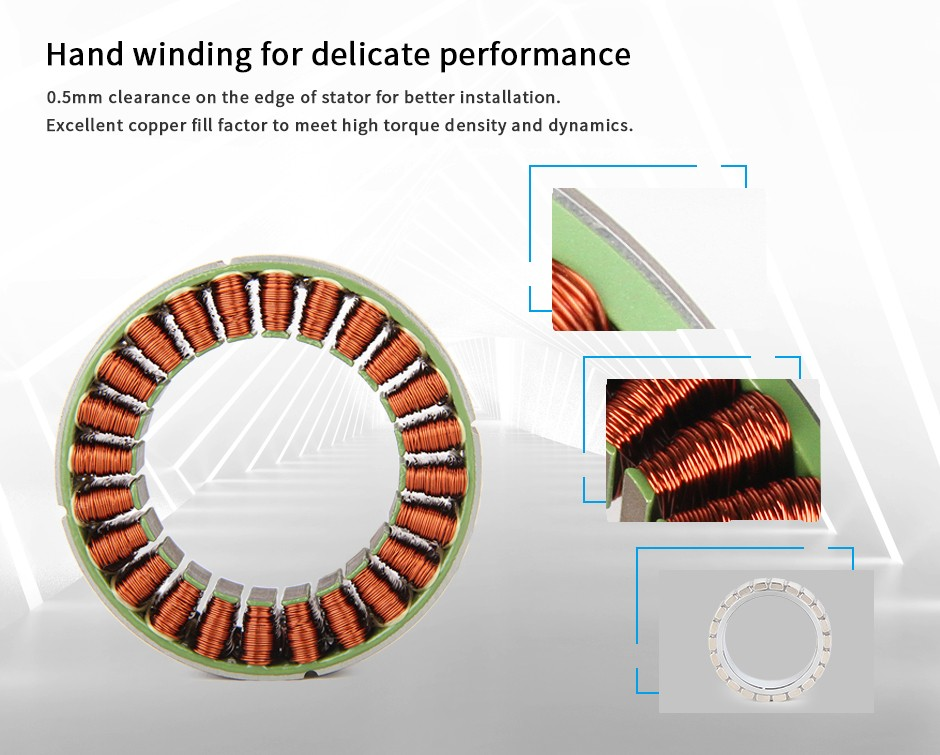

# CubeMars RI60 KV120

```sh
python3 examples/commercial/cubemars/run.py
```

| Model (quarter cutaway) | Flux density and paths |
|---|---|
| [](model-3d.png) | [](field.png) |

Model magnets: red N, blue S.

Stator midplane at 0° mechanical and optimized 5.5 W copper loss. Colour: total
|B|, 0–3 T; curves: the in-plane field, with spacing decreasing as flux increases.

[Geometry sections](model.png)

## Sources

[Specifications and CAD](https://www.cubemars.com/goods-857-RI60%2BKV120.html) · [Magnet photograph](https://www.cubemars.com/images/20230314/1678778688841331.jpg) · [Original CAD](https://www.cubemars.com/data/cms/202602/ri60-frameless-torque-motor-without-hall-sensor-3d-drawing.zip)



Manufacturer winding photograph used to support the 24-tooth reconstruction. [Original image](https://www.cubemars.com/images/20230314/1678778688893387.jpg). The 28 curved tile profiles come from the CAD, not this photograph.

## Assumptions

| Parameter | Value | Source or assumption |
|---|---|---|
| Envelope; poles | OD 60, bore 30, stack 13, overall 23 mm; 28 poles | Manufacturer specifications and integration CAD. |
| Rotor geometry | Exact 28 curved PM tile shapes; r = 17 mm carrier interface; outer PM radius 17.9 mm | Recovered from the public STEP; nominal radial PM thickness 0.9 mm and rotor length 15 mm. |
| Gap / stator count | Stator bore radius 18.5 mm; 0.6 mm clearance; 24 teeth | CAD integration gap and repeated teeth in manufacturer photo/CAD. |
| Hidden stator | 1.7 mm yoke; 2.6 mm teeth; 0.9 mm shoes, 90.7% pitch coverage | Assumed interior under the winding pack. |
| Copper envelope | r = 19.6…27.9 mm; outer half-width/height 2.25/9.8 mm | Assumed pack; 0.15 mm lateral and 0.10 mm axial inner clearance. |
| Winding | Delta; 27 turns/tooth; 29.05% actual copper fill | 30% target leaves about 4 g for inactive material. A 60% candidate exceeded catalog mass by 29 g; chosen before torque solves. |
| Resistance / inductance | Rll = 0.900 Ω → phase branch 1.350 Ω; Lll = 0.8775 mH | Catalog; eight series coils per branch. Star-equivalent inductance divided by three for delta terminals. |
| Current convention | Kt = 0.100 N·m per RMS line A | Inferred from Kv = 120 rpm/V and Ke = 9.03 V/krpm; the ADC label is ambiguous. |
| Materials | Br = 1.32 T, μr = 1.05; M19 95% stack; generic steel carrier | Grades unpublished. Magnet vectors follow each recovered tile orientation. |
| Mass | 151.7 g active vs 155.9 g catalog | Generic Cu/steel/PM densities and CAD volume audit. |

All winding phases/signs are explicit in [run.py](run.py). The shared M19
curve is the released [FEMM material](../../benchmarks/lrk/model.fem), with
95% effective in-plane stack factor; the 3D material law is isotropic.
Audit densities are Cu 8960, steel 7850 and PM 7600 kg/m³ unless stated above.
The meshes use a 0.8 mm surface size and an air radius twice the catalog OD.

## Results

| Comparison at 5.5 W copper loss, 20°C | Simulation | Catalog equivalent | Difference |
|---|---:|---:|---:|
| Mean torque, N·m | 0.19805 | 0.20184 | -1.9% |

Catalog torque at this loss is `Kt sqrt(P / (1.5 Rll))`, using Kt = 0.100 N·m per RMS line A and Rll = 0.900 Ω.

Currents are optimized independently at 5.5 W total copper loss and 20°C.
Angles below are electrical; the solve API takes mechanical angle = electrical
angle / pole pairs. The reported mean uses these five positions. `run.py` solves 0°.

| Electrical angle | Torque, N·m |
|---:|---:|
| 0° | 0.19835965 |
| 12° | 0.19643078 |
| 24° | 0.19947446 |
| 36° | 0.19848026 |
| 48° | 0.19751870 |

The small torque difference is sensitive to the mass-based fill estimate, remanence and inferred current convention. Terminal inductance is 1.189 versus 0.878 mH (+35.5%), so close torque does not establish the internal stator/winding reconstruction. The published Km = 0.1054 uses Kt/√Rll; the sinusoidal copper-loss conversion used here is Kt/√(1.5 Rll).
