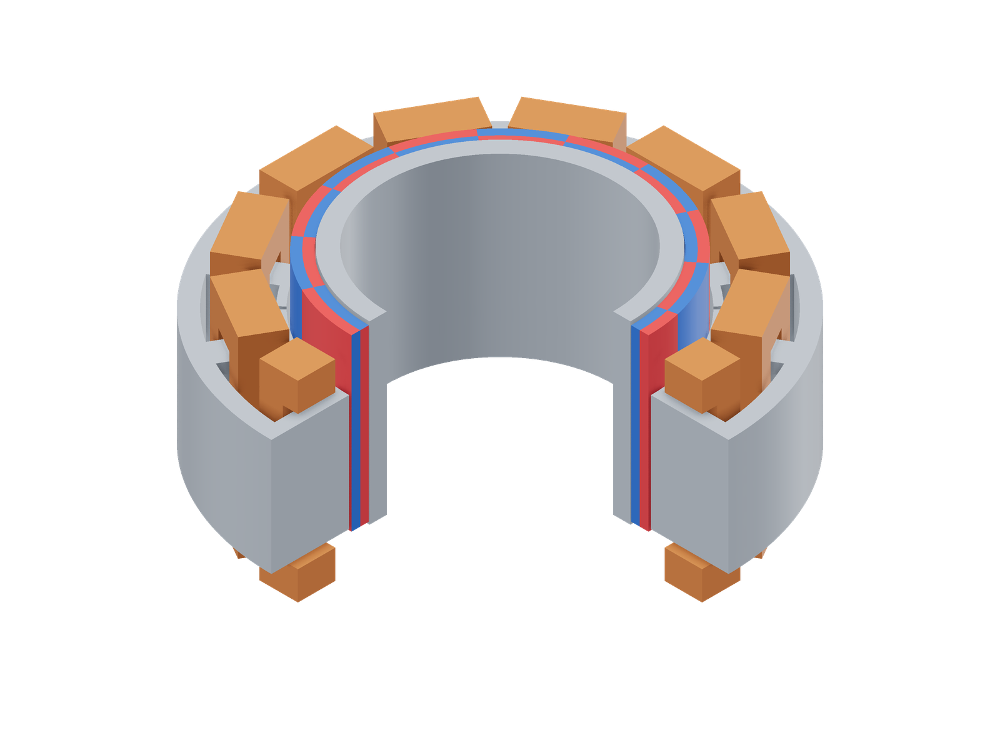
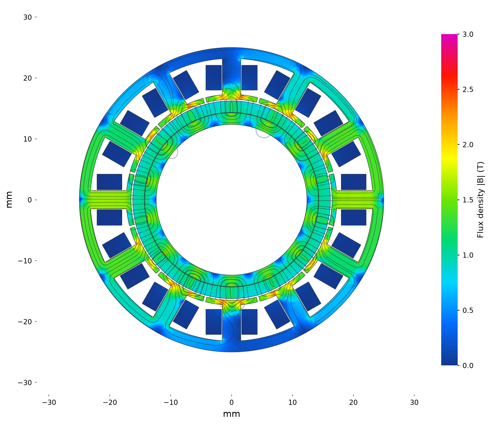
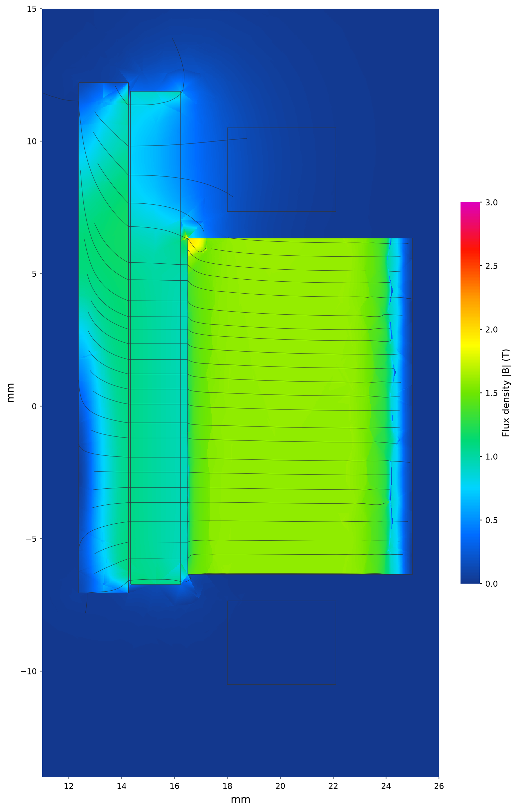
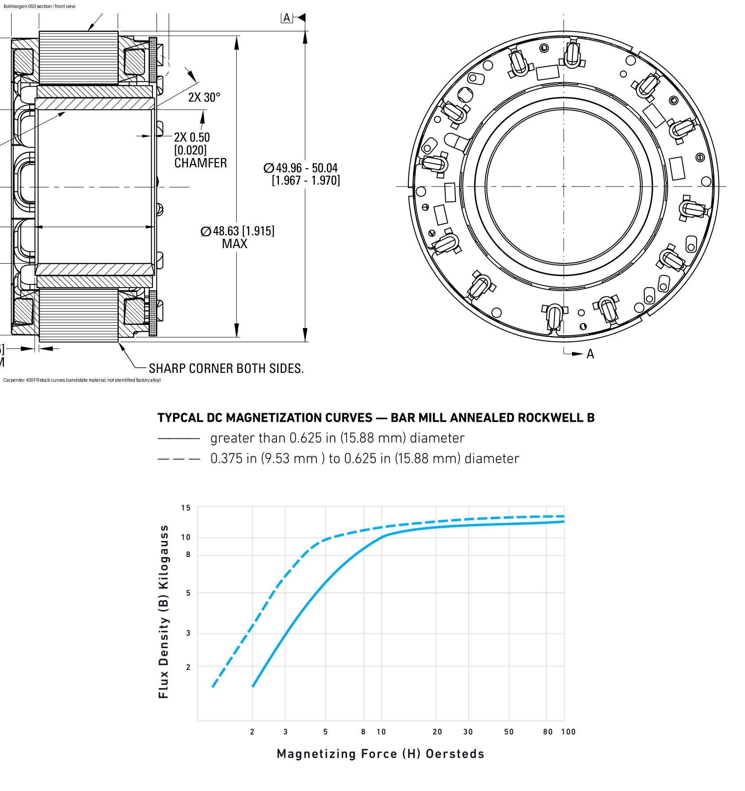

# Kollmorgen TBM2G-05013A

```sh
python3 examples/commercial/kollmorgen/run.py
```

| Model (quarter cutaway) | Flux density and paths |
|---|---|
| [](model-3d.png) | [](field.png) |

Model magnets: red N, blue S.

Stator midplane at 0° mechanical and optimized 5.5 W copper loss. Colour: total
|B|, 0–3 T; curves: the in-plane field, with spacing decreasing as flux increases.



A shaft section through the positive-radius side shows the +2.58 mm rotor
offset and asymmetric end fringing, on the same colour and physical line scales.

[Geometry sections](model.png)

## Sources

[Product](https://www.kollmorgen.com/en-us/products/motors/direct-drive/tbm2g-series-frameless) · [Selection guide](https://www.kollmorgen.com/sites/default/files/2025-12/TBM2G-KM_SG_00396_RevB_EN.pdf) · [Drawing source](https://www.kollmorgen.cn/sites/default/files/TBM2G-KM_SG_00396_RevA_EN.pdf) · [Installation manual](https://www.kollmorgen.com/sites/default/files/2023-08/TBM2G_Installation-ge-en-it-sp-fr_0.pdf) · [430FR data](https://www.carpenterelectrification.com/hubfs/Resources/Datasheets/20200622-CT_430FR-Solenoid-Quality-Data-Sheet.pdf) · [Ring-magnet grades](https://allianceorg.com/magnetic-materials/radially-oriented-ndfeb-hot-pressed-neo/)



Selection-guide section and front view used for the profile estimates. The nominal left-edge offset comes from the [installation manual](https://www.kollmorgen.com/sites/default/files/2023-08/TBM2G_Installation-ge-en-it-sp-fr_0.pdf), not centering the two rings. The lower panel shows the [Carpenter 430FR stock curves](https://www.carpenterelectrification.com/hubfs/Resources/Datasheets/20200622-CT_430FR-Solenoid-Quality-Data-Sheet.pdf) used as a rotor-material candidate.

## Assumptions

| Parameter | Value | Source or assumption |
|---|---|---|
| Envelope; poles | OD 50, bore 24.75, stack 12.70, overall 24.34 mm; 14 poles | Selection guide; the front view supports 12 repeated winding/insulator units. |
| Rotor profile | PM radii ≈14.340…16.240 mm, length ≈18.60 mm; yoke radius ≈14.264 mm, length 19.26 mm | Vector paths scaled by the dimensioned 12.70 mm stack; undimensioned profile estimates. |
| Placement / clearances | Rotor center +2.58 mm; radial air gap ≈0.265 mm; bond clearance ≈0.076 mm | Mounting guide specifies 0.70 ± 0.40 mm between left lamination and yoke edges; center shift = (19.26−12.70)/2−0.70. |
| Hidden stator | 12 slots; 1.8 mm yoke; 3.0 mm teeth; 0.8 mm shoes, 95.3% pitch coverage | Internal tooth and yoke geometry remain assumptions. |
| Copper envelope | r = 18.0…22.1 mm; outer half-width/height 4.2/10.5 mm; inner 1.65/7.35 mm | Radial and axial head extents from the section; symmetric mean of end heights. Tangential width remains assumed. |
| Winding | Star; 42 turns/tooth; 59.72% copper fill; about 0.45 mm wire | One pass from independent Lq: round(43√(1.240/1.317)) = 42; R then fixes copper area/fill. L is a reconstruction constraint, not a held-out validation. |
| Resistance / inductance | 1.78 Ω at 25°C → 1.74570 Ω at 20°C; Lq,ll = 1.240 mH | Selection guide; four series coils per phase give 0.218212 Ω per coil. |
| Magnets | Reference Br = 1.24 T, μr = 1.05; full alternating radial poles | Declared 1.18/1.24/1.32 T ring-grade candidates; factory grade, transition width and skew are unpublished. |
| Rotor steel | Published annealed 430FR stock curve; 7584 kg/m³ | Candidate for the documented 400-series steel. Measured curve ends at 7958 A/m; the monotone high-field extension approaches 1.52 T polarization and is assumed. |
| Stator steel | M19 effective 95% stack | Unverified electrical-steel grade; isotropic B-H approximation. |
| Independent geometry checks | 0.1017 vs 0.1040 kg·cm² rotor inertia; 136.2 vs 149 g active/catalog mass | Inertia and catalog mass are estimates; neither was used to fit torque. |

All winding phases/signs are explicit in [run.py](run.py). The shared M19
curve is the released [FEMM material](../../benchmarks/lrk/model.fem), with
95% effective in-plane stack factor; the 3D material law is isotropic.
Audit densities are Cu 8960, steel 7850 and PM 7600 kg/m³ unless stated above.
The meshes use a 0.8 mm surface size and an air radius twice the catalog OD.

## Results

| Comparison at 5.5 W copper loss, 20°C | Simulation | Catalog equivalent | Difference |
|---|---:|---:|---:|
| Mean driven torque, N·m | 0.20251 | 0.19656 | +3.0% |

The published Km = 0.083 N·m/√W at 25°C is corrected to 20°C using the copper resistance ratio. The catalog Kt is 0.136 N·m per RMS phase A.

Currents are optimized independently at 5.5 W total copper loss and 20°C.
Angles below are electrical; the solve API takes mechanical angle = electrical
angle / pole pairs. The reported mean uses these five positions. `run.py` solves 0°.

| Electrical angle | Total torque, N·m | Driven torque, N·m |
|---:|---:|---:|
| 0° | 0.20459607 | 0.20853933 |
| 12° | 0.20494301 | 0.19588634 |
| 24° | 0.19640217 | 0.20114288 |
| 36° | 0.20995352 | 0.20469982 |
| 48° | 0.19191584 | 0.20229389 |

Magnet grade and pole transitions dominate the remaining uncertainty. At zero angle and identical currents, 1.18/1.24/1.32 T give 0.20173/0.20837/0.21681 N·m. These candidates were declared before torque comparison. The reference is not a recovered factory grade. Refining 0.8→0.55 mm changes driven torque by −0.76%; Lq is 1.271 versus 1.240 mH.

The comparison uses `(T(+I) − T(−I))/2` at each of five electrical angles. The raw total-torque mean is 0.20156 N·m (+2.5%); the 1.24 T fine zero-angle driven result is 0.20680 N·m.
