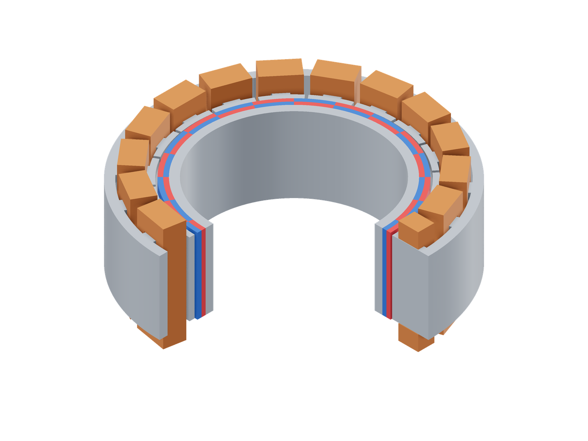
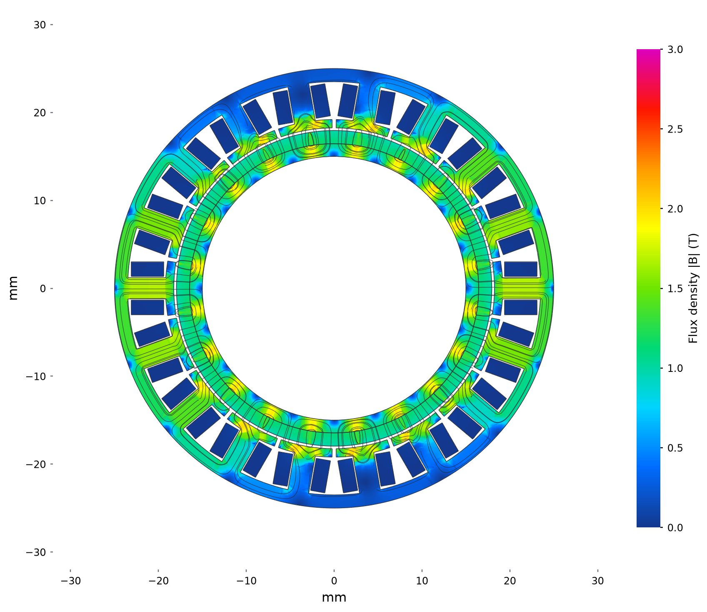
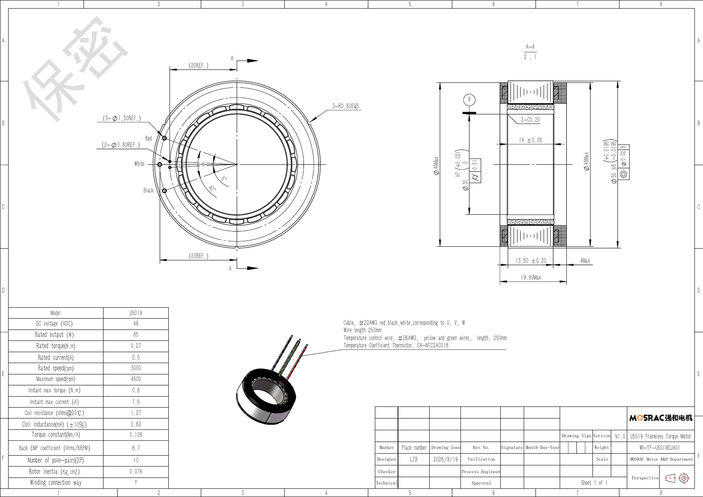

# Mosrac U5019

```sh
python3 examples/commercial/mosrac/run.py
```

| Model (quarter cutaway) | Flux density and paths |
|---|---|
| [](model-3d.png) | [](field.png) |

Model magnets: red N, blue S.

Stator midplane at 0° mechanical and optimized 5.5 W copper loss. Colour: total
|B|, 0–3 T; curves: the in-plane field, with spacing decreasing as flux increases.

[Geometry sections](model.png)

## Sources

[Product](https://www.mosrac.com/products/frameless-direct-drive-torque-motors/u50-series.html) · [Catalog](https://www.mosrac.com/uploads/pdf/mosrac-u5019-motor-catalog.pdf) · [Original CAD](https://www.mosrac.com/uploads/pdf/mosrac-u5019-motor-catalog.zip)



Manufacturer outline drawing; integration dimensions constrain the envelope, not the hidden tooth or winding geometry. [Original catalog](https://www.mosrac.com/uploads/pdf/mosrac-u5019-motor-catalog.pdf).

## Assumptions

| Parameter | Value | Source or assumption |
|---|---|---|
| Envelope; poles | OD 50, bore 30, stack 13.5, overall 19.9 mm; 20 poles | Manufacturer catalog and integration CAD. |
| Rotor and gap | Rotor radius 17.95, stator bore radius 18.25 mm; length 14 mm | Integration CAD; 0.30 mm radial clearance. |
| Magnet / backing | 1.50 mm radial magnet thickness; steel backing to the 15 mm bore radius | Assumed internal split of the integration rotor envelope. |
| Hidden stator | 18 slots; 1.5 mm yoke; 2.4 mm teeth; 0.95 mm shoes, 93% pitch coverage | Reconstructed internal geometry; not exposed by the integration CAD. |
| Copper envelope | r = 19.4…23.1 mm; outer half-width/height 3.0/9.65 mm | Assumed winding pack; 0.15 mm lateral and 0.10 mm axial inner clearance. |
| Winding | Star; 23 turns/tooth; 51.39% actual copper fill | 50% target leaves mass allowance for inactive parts; integer turns from resistance and CAD mean turn length. |
| Resistance / inductance | 1.27 Ω / 0.820 mH line-line | Catalog “coil resistance” interpreted as terminal resistance; six series coils per phase. |
| Current convention | 0.108 N·m per peak phase A | Inferred: Ke = 8.7 Vrms/krpm predicts about 0.1018 N·m/peak A; RMS would imply 0.1439. |
| Materials | Br = 1.32 T, μr = 1.05, full radial poles; M19 95% stack and generic steel rotor | Unverified magnet grade, pole transitions and steel grades. |
| Mass | 109.3 g active vs 116 g catalog | A 60% fill candidate was too heavy; 50% was selected before torque solves. |

All winding phases/signs are explicit in [run.py](run.py). The shared M19
curve is the released [FEMM material](../../benchmarks/lrk/model.fem), with
95% effective in-plane stack factor; the 3D material law is isotropic.
Audit densities are Cu 8960, steel 7850 and PM 7600 kg/m³ unless stated above.
The meshes use a 0.8 mm surface size and an air radius twice the catalog OD.

## Results

| Comparison at 5.5 W copper loss, 20°C | Simulation | Catalog equivalent | Difference |
|---|---:|---:|---:|
| Mean torque, N·m | 0.24661 | 0.25952 | -5.0% |

Catalog torque at this loss is `Kt sqrt(4 P / (3 Rll))`, using Kt = 0.108 N·m per peak phase A and Rll = 1.27 Ω.

Currents are optimized independently at 5.5 W total copper loss and 20°C.
Angles below are electrical; the solve API takes mechanical angle = electrical
angle / pole pairs. The reported mean uses these five positions. `run.py` solves 0°.

| Electrical angle | Torque, N·m |
|---:|---:|
| 0° | 0.24566712 |
| 12° | 0.23839058 |
| 24° | 0.24839702 |
| 36° | 0.24421603 |
| 48° | 0.25640243 |

The most sensitive assumptions are remanence, fill and the peak/RMS and resistance-label interpretation. Back EMF supports the chosen convention, but does not establish the hidden winding. Loaded mean terminal inductance is 0.881 versus 0.820 mH (+7.4%).
