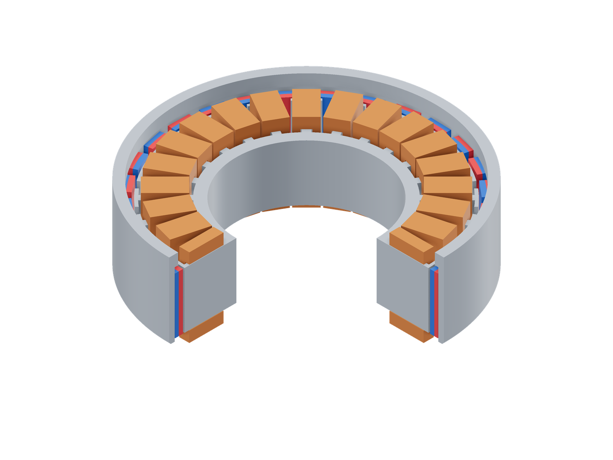
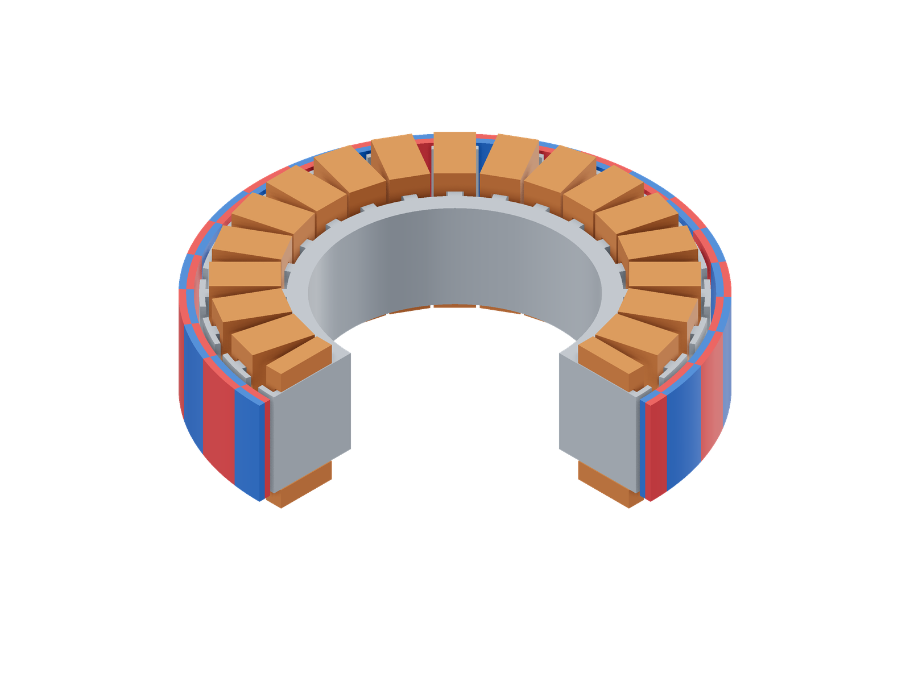
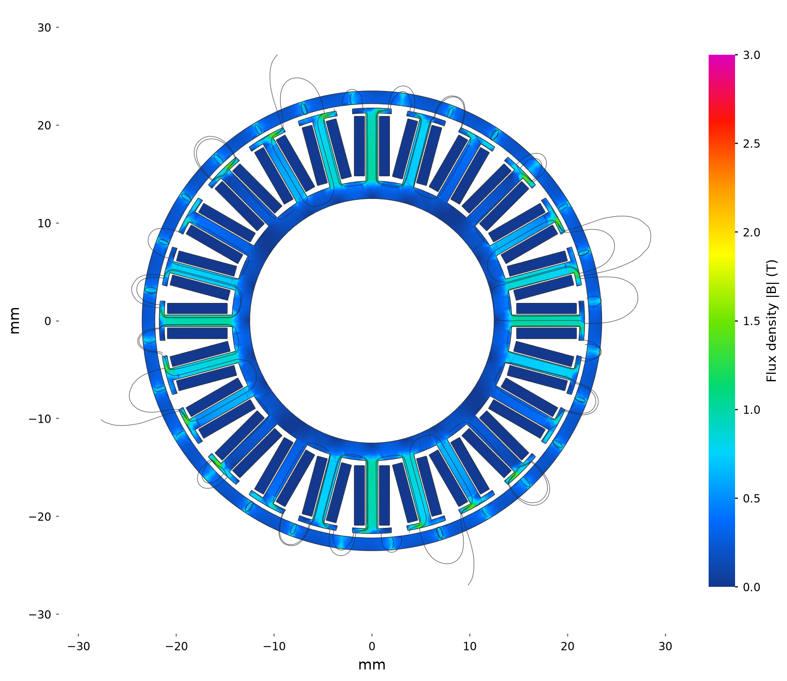
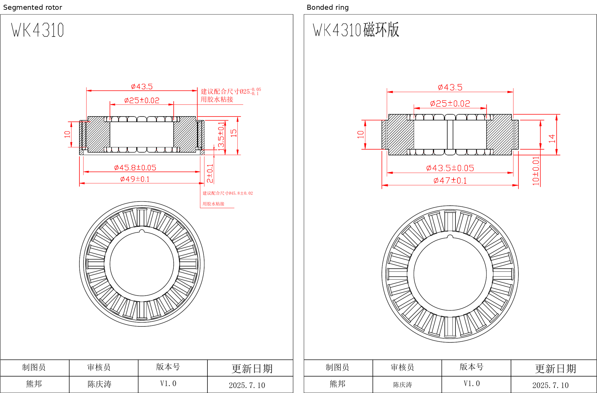

# Steadywin WK4310

```sh
python3 examples/commercial/steadywin/run.py         # Segmented magnets
python3 examples/commercial/steadywin/run.py --ring  # Bonded ring
```

| Segmented rotor (quarter cutaway) | Flux density and paths |
|---|---|
| [](model-3d.png) | [](field.png) |

| Bonded ring (quarter cutaway) | Flux density and paths |
|---|---|
| [](ring-model-3d.png) | [](ring.png) |

Model magnets: red N, blue S.

Stator midplane at 0° mechanical and optimized 5.5 W copper loss. Both use the
common 0–3 T scale and inverse-B line spacing. The segmented carrier closes more
flux through the teeth; the bonded ring shows lower loading and more leakage.

## Sources

[Product and both rotor versions](https://steadywin-motor.com/products/wholesale-mini-size-11mm-dc-brushless-frameless-motor-for-gimbal-camera)
· [Selection table](https://islandcloud.co/link/69ca477e86ba03471d40ee19/10e89476-287f-4cd8-9fd9-df90432f4d7d)
· [Manufacturer archive containing the WK4310 datasheet](https://islandcloud.co/link/689efa1586b8201b11f4cf10/40df0eac-66f8-4dd5-8ea5-3a6065f37c49)

| Version | Original CAD | Original drawing |
|---|---|---|
| WK4310CP, segmented | [STEP](https://islandcloud.co/link/69cdcabf7550593c7ed35d1e/5a7ac023-46b2-4034-9a04-dbb6a67eb870) | [PDF](https://islandcloud.co/link/69cdcabf7550593c7ed35d1d/80acca97-cef6-4b3f-bc7c-f04bbd753047) |
| WK4310CH, ring | [STEP](https://islandcloud.co/link/69cdcabf7550593c7ed35d20/496e322c-7ed2-4714-95f0-0129dece7d2a) | [PDF](https://islandcloud.co/link/69cdcabf7550593c7ed35d1f/05d3dd9e-d758-4a44-ab2f-6d5fdb99ac88) |



The selection table gives 60 turns, 14 pole pairs, Rll = 10.32 Ω,
Lll = 4.758 mH, Kt = 0.23 N·m/A, 78 g mass and 161 g·cm² rotor inertia for
WK4310. Its rated/stall torques are 0.20/0.49 N·m. The product page identifies
the two versions and states that ring-rotor torque is 50% lower. The ring
reference below applies that stated ratio with the common winding resistance.

## Assumptions

| Parameter | Value | Source or assumption |
|---|---|---|
| Shared stator | 25 mm bore, 43.5 mm OD, 10 mm stack; 24 teeth | Both CADs contain the same stator envelope; exposed tooth caps are retained at r = 21.25…21.75 mm. |
| Segmented rotor | Exact carrier and 28 magnet bodies; each magnet is 1.4 × 3.7 × 10 mm | Recovered from the segmented STEP. Rotor OD is 49 mm; mounting length is 13.5 mm. |
| Ring rotor | r = 22.2…23.5 mm; length 10 mm; 28 alternating poles | Exact ring from its separate STEP; 47 mm rotor OD. The 0.45 mm radial gap follows the CAD. |
| Position | Shaft along +z; stack centered at the origin; ring pole offset -1.40525° | CADs recentered to the same shaft and stack midplane. The offset aligns the first north pole with the segmented rotor. |
| Hidden stator | 14.3 mm hub radius; 1.2 mm tooth necks | Interior estimates inside the drawing outline, checked against total mass before torque solving. |
| Copper envelope | r = 14.8…20.9 mm; outer half-width/height 1.8/7.0 mm; inner 0.75/5.1 mm | Rectangular approximation to the CAD/drawing winding pack. CAD winding height is 14 mm; the segmented drawing labels 15 mm overall stator height. |
| Winding | Star; 60 turns/tooth; eight series coils/phase; 0.645 Ω/coil | Published turns interpreted per tooth; star connection assumed. R and mean turn length give 38.58% actual copper fill at 20°C. |
| Segmented magnets | Br = 1.32 T, μr = 1.05; alternating uniform directions | Ordinary sintered-NdFeB candidate; factory grade is unpublished. Pole centers follow the recovered tile positions. |
| Bonded ring | Br = 0.68 T, μr = 1.2; full radial poles | Generic [MQP-B-type bonded NdFeB](https://mqitechnology.com/wp-content/uploads/2018/10/mqp-b-20441-070.pdf); factory grade and magnetization waveform are unpublished. |
| Steel | M19 effective 95% stack; generic steel rotor carrier | Shared [FEMM M19 data](../../benchmarks/lrk/model.fem); isotropic B–H approximation. Actual grades are unknown. |
| Auxiliary end part | Omitted from the magnetic model | Assumed nonmagnetic bonding/retaining material. Treating it as steel raises calculated rotor inertia about 7% above catalog. |
| Current convention | Assumed commutated line-current Kt | 9.549/Kv ≈ 0.222 N·m/A agrees with published Kt = 0.230. Waveform is unspecified. Ring Kt is taken as half the segmented value, with the same winding. |

Mass checks use Cu 8960, steel 7850 and segmented PM 7600 kg/m³. The segmented
active model is 77.47 g versus 78 g catalog; rotor inertia is 156.24 versus
161 g·cm² (-3.0%). Assuming 5900 kg/m³ for the bonded ring gives 60.16 g active
mass; a separate ring-version mass is unpublished. Geometry, turns and grades
were fixed before torque comparison.
Coil phases and signs in [run.py](run.py) follow the 24-slot, 28-pole
concentrated winding; coils of the same phase are in series.

## Results

| At 5.5 W total copper loss, 20°C | Catalog equivalent, N·m | Simulation, N·m | Difference |
|---|---:|---:|---:|
| Segmented magnets | 0.16791 | 0.18038 | +7.4% |
| Bonded ring | 0.08395 | 0.08083 | -3.7% |

The catalog conversion uses `Kt sqrt(P / Rll)` for two-phase commutated
current. This convention is inferred from Kt and Kv, not specified by the
manufacturer. Interpreting Kt as sinusoidal peak-phase current instead gives
0.19388 / 0.09694 N·m for segmented / ring, and differences of -7.0% / -16.6%.

Our currents are optimized independently at each position. For near-sinusoidal
back EMF, sinusoidal drive can deliver about 5% more torque at the same heating
than block commutation ([maxon explanation](https://support.maxongroup.com/hc/en-us/articles/360006288554-Strength-of-BLDC-EC-motor-with-sinusoidal-commutation)).
This is a plausible contributor to the segmented version's positive difference;
Steadywin's actual back-EMF waveform remains unknown.

| Electrical angle | Segmented torque, N·m | Ring torque, N·m |
|---:|---:|---:|
| 0° | 0.17136259 | 0.07966631 |
| 12° | 0.19195096 | 0.08191974 |
| 24° | 0.16795761 | 0.07929212 |
| 36° | 0.18925635 | 0.08083566 |
| 48° | 0.18135273 | 0.08243452 |

The comparison uses the mean of these five positions. `run.py` solves 0°;
the solve API takes mechanical angle = electrical angle / 14. Mesh size is
0.8 mm and air radius 98 mm for both versions. The field images show the 0°
solutions on the common 0–3 T scale.

The most sensitive assumptions are current definition, hidden tooth geometry
and magnet grade. The ring's actual remanence and pole waveform could account
for its remaining difference. The loaded segmented model's mean differential
terminal inductance is 3.061 mH versus 4.758 mH catalog. At zero drive current
it is 2.928 mH (-38.5%), so the gap persists without load current. Hidden tooth
neck/core geometry and the rectangular end-turn approximation are leading
explanations. Torque agreement alone does not establish the hidden core.
