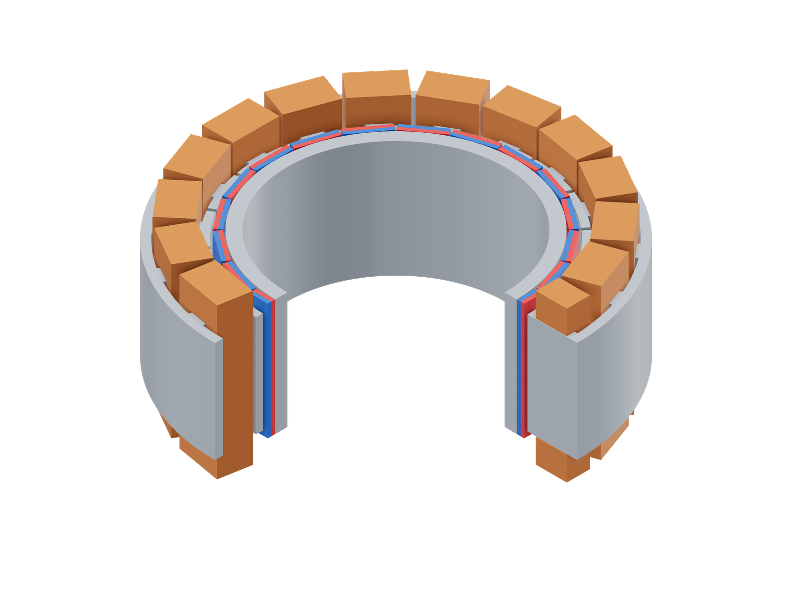
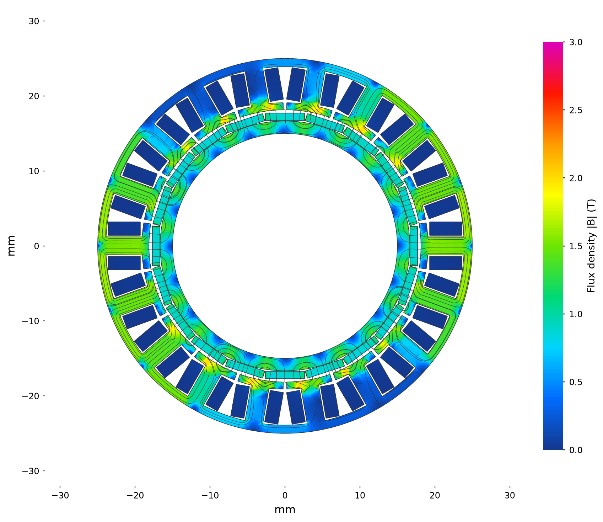
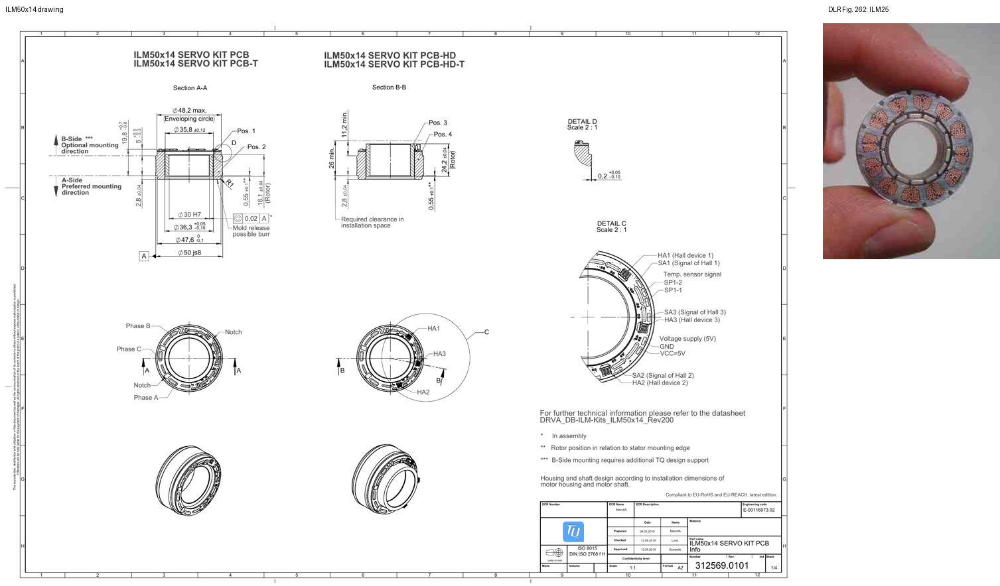

# TQ ILM50x14

```sh
python3 examples/commercial/tq/run.py
```

| Model (quarter cutaway) | Flux density and paths |
|---|---|
| [](model-3d.png) | [](field.png) |

Model magnets: red N, blue S.

Stator midplane at 0° mechanical and optimized 5.5 W copper loss. Colour: total
|B|, 0–3 T; curves: the in-plane field, with spacing decreasing as flux increases.

[Geometry sections](model.png)

## Sources

[Product](https://www.tq-group.com/en/products/tq-robodrive/motors-drive-solutions/motor-kits/ilm50x14/) · [FAQ](https://www.tq-group.com/en/support/faq/tq-robodrive/) · [Datasheet](https://www.tq-group.com/filedownloads/files/products/robodrive/extended_data-sheets/DRVA_DB-ILM-Kits_ILM50x14_Rev201.pdf) · [Integration CAD](https://www.tq-group.com/filedownloads/files/products/robodrive/3d_files/3D_File_ILM50x14_Rev.0101.step.zip) · [Unpotted CAD](https://www.tq-group.com/filedownloads/files/products/robodrive/3d_files/3D-File_ILM-E_50x14_Rev.0100_01.zip) · [Dimension drawing](https://www.tq-group.com/filedownloads/files/products/robodrive/drawing/drawing_ilm50x14_rev.0101.pdf)



Left: the manufacturer dimension drawing used for the winding envelope. Right: DLR status report, Fig. 262, printed p. 128: **ILM25**, not ILM50. The image supports dense winding qualitatively; it does not establish 75.6% copper fill or the ILM50 turn count. [Original report](https://www.dlr.de/de/rm/downloads/allgemeines/rmc/DLR-RM-IB-2009-web_status_report.pdf/@@download/file).

## Assumptions

| Parameter | Value | Source or assumption |
|---|---|---|
| Envelope; poles | OD 50, bore 30, stack 14, overall 22.6 mm; 20 poles | Manufacturer datasheet and integration CAD. |
| Stator count | 18 segments / concentrated tooth coils | 20° repetition of the unpotted ILM-E CAD; the FAQ supports transferring its core geometry to ILM. |
| Rotor and gap | 16.1 mm long; 0.25 mm radial gap | Integration drawing/CAD. |
| Magnet tiles | 1.00 mm thick, 5.2163 mm wide; 0.05 mm bond | Thickness and bond assumed; width solved from the published 0.090 kg·cm² inertia using 7500/7850 kg/m³ PM/steel densities. |
| Hidden stator | 1.1 mm yoke; 2.4 mm tooth width; shoe outer radius 19.1 mm; 93% pitch coverage | Assumed internal geometry; the potted CAD does not expose it. |
| Copper envelope | r = 19.3…23.5839 mm; outer half-width/height 3.2/10.4 mm; inner 1.4/7.1 mm | Head OD 47.6 mm and axial envelope from drawing; rectangular pack shape and internal clearances assumed. |
| Winding | Star; 24 turns/tooth; 75.60% bare-copper fill | High-fill candidate scenario; integer turns and fill linked through CAD turn length and terminal resistance. |
| Resistance / inductance | 0.770 Ω / 0.850 mH line-line at 20°C | Datasheet; six series coils per phase give 0.0641667 Ω per coil. |
| Magnets | Br = 1.39 T, μr = 1.05; alternating uniform tile vectors | Unverified high-remanence candidate, not an identified factory grade. |
| Steel | M19 effective 95% stack; generic steel rotor | Public FEMM material data; actual TQ steel grade is unpublished. |
| Mass | 132.5 g active vs 135 g catalog | Cu/steel/PM audit; active model omits PCB, resin and leads. |

All winding phases/signs are explicit in [run.py](run.py). The shared M19
curve is the released [FEMM material](../../benchmarks/lrk/model.fem), with
95% effective in-plane stack factor; the 3D material law is isotropic.
Audit densities are Cu 8960, steel 7850 and PM 7600 kg/m³ unless stated above.
The meshes use a 0.8 mm surface size and an air radius twice the catalog OD.

## Results

| Comparison at 5.5 W copper loss, 20°C | Simulation | Catalog equivalent | Difference |
|---|---:|---:|---:|
| Mean torque, N·m | 0.31612 | 0.31895 | -0.9% |

Catalog torque at this loss is `Km sqrt(P)`, using the published Km = 0.136 N·m/√W.

Currents are optimized independently at 5.5 W total copper loss and 20°C.
Angles below are electrical; the solve API takes mechanical angle = electrical
angle / pole pairs. The reported mean uses these five positions. `run.py` solves 0°.

| Electrical angle | Torque, N·m |
|---:|---:|
| 0° | 0.31042616 |
| 12° | 0.30697264 |
| 24° | 0.31673556 |
| 36° | 0.31813566 |
| 48° | 0.32831383 |

The small torque difference is especially sensitive to copper fill and magnet remanence. It is not an identified factory winding: zero-current inductance is 1.186 mH versus 0.850 mH (+39.5%). Inferring turns from inductance instead gives 18–20 turns and a 15–30% torque-constant shortfall. Unknown end-turn geometry, turns and core/material details are the leading explanation for that conflict.

The held-out 5.3 A peak-phase check gives 0.505 N·m versus 0.540 N·m, at 16.22 W copper loss. The 0.8→0.5 mm zero-angle torque change is 0.14%.
