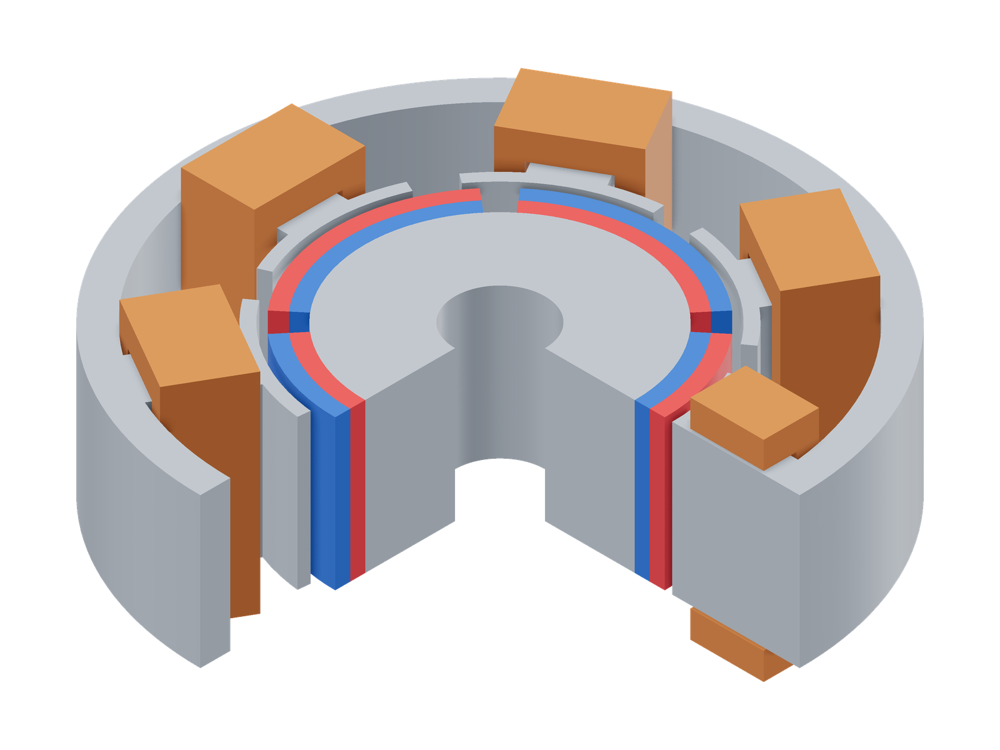
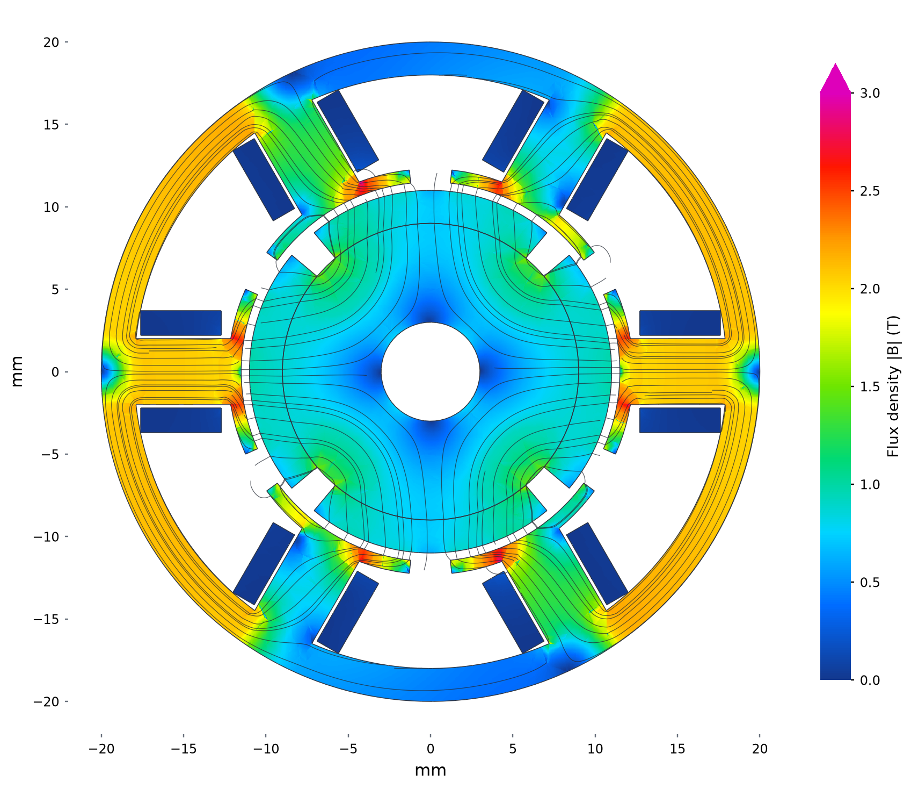

# Six-coil BLDC inrunner

| Model (quarter cutaway) | Flux density and paths |
|---|---|
| [](model-3d.png) | [](field.png) |

Model magnets: red N, blue S.

Stator midplane at 0° and optimized 5.5 W copper loss. The common 0–3 T scale
shows concentration at tooth tips and roots; curves follow in-plane B. The upper
colourbar triangle marks the few samples above 3 T.


```sh
python3 examples/simple/run.py
```

[Geometry section](model.png)

## Sources

An original teaching model, included as [motor.step](motor.step), with six
tooth coils and four curved permanent magnets. Stator B–H data comes from
[Kede's 1J22 datasheet](https://www.kedemagnetics.com/download/datasheet-of-soft-magnetic-materials-at-room-temperature.pdf).

## Assumptions

| Part | Dimensions or setting |
|---|---|
| Stator | 40 mm OD, 10 mm stack, 2 mm back iron; six 4 mm-wide teeth |
| Rotor | Steel, radii 3–9 mm, length 10 mm; rotates about +z |
| Magnets | Radii 9–11 mm, 80° arc each, length 10 mm; alternating north-out / south-out |
| Air gap | 0.5 mm radial clearance |
| Coils | 30 turns each; two opposite coils per phase, in series |
| Copper | Default 60% fill at 20°C; resistance calculated from the STEP dimensions |

Coils 1–6 run counterclockwise from +x, with phases A, B, C, A, B, C.
Each coil's direction points outward along its tooth: positive current follows
the right-hand rule around that direction. Magnets 1–4 run counterclockwise
from +x. Default magnets use Br = 1.2 T and relative permeability 1.05.
The rotor uses the default steel curve; housing, bearings and losses outside
the copper are omitted.

## Results

At the STEP position and 5.5 W total copper loss, the default solve gives
approximately **0.073 N·m**. Optimized instantaneous phase currents are
A ≈ 0, B ≈ +3.391 A and C ≈ -3.391 A. This is a teaching example with chosen
dimensions, without a manufacturer torque rating.
