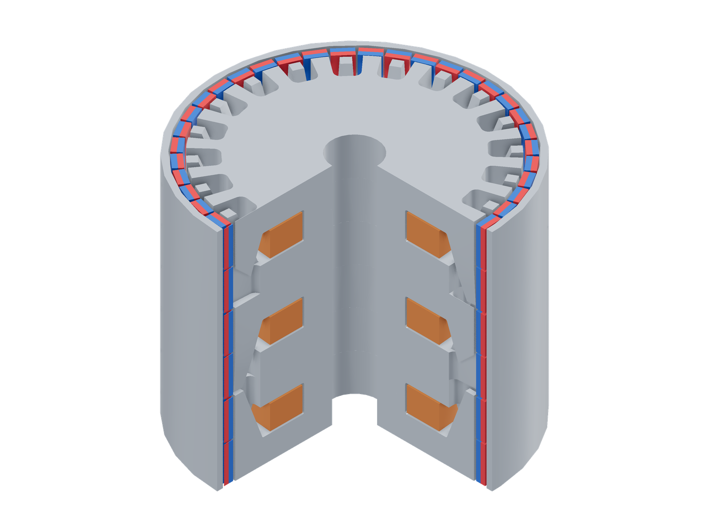
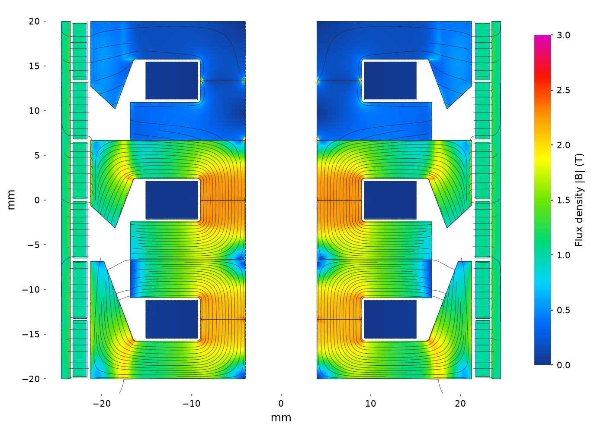

# 40 mm transverse-flux motor

```sh
python3 examples/transverseflux/run.py
```

Transverse flux outrunner with 3 phases axially stacked: 49 mm OD, 40 mm length and 8 mm bore.
Six claw cups surround three annular foil coils; two magnet rows per phase
share 40 angular columns. The included [motor.step](motor.step) is the named,
colored assembly.

| Model (quarter cutaway) | Flux density and paths |
|---|---|
| [](model-3d.png) | [](field.png) |

Model magnets: red N, blue S.

Longitudinal section at the saved weak-angle currents: 0–3 T, with in-plane
flux paths. Axial position is vertical; the shaft is the central blank region.

| Setting | Value |
|---|---|
| Pole pairs | 20 |
| Coils | 65 turns per phase, positive current about +z |
| Winding | 76.2 µm copper + 12.7 µm insulation; 4.2333 mm foil width |
| Phase resistance | 0.3706134193 Ω at 120°C; winding only |
| Stator | Kede 1J21 B–H proxy; 4.25 mm cup roots |
| Rotor sleeve | 1 mm steel; package default B–H curve |
| Magnets | 240 B421SH blocks, 6.35 × 3.175 × 1.5875 mm; Br = 1.2 T, μr = 1.05 |
| Working gap | 0.35 mm radial |
| Contacts | 10 µm effective gap at iron mating surfaces |

Stator phases are clocked 0°, 6° and 12° mechanically. All six magnet rows
are aligned; pole 1 points outward, with alternating radial polarity.
The solve optimizes balanced-star currents at **5.5 W winding loss**, at the
previous sampled weak pose: **3.796875° mechanical = 75.9375° electrical**.
This is one rotor position; it does not establish an angular minimum or a
continuous thermal rating. Tabs, leads and joints are excluded from the loss.

The default solve gives **1.85056 N·m**, with phase currents
A = +3.1396 A, B = −1.4041 A and C = −1.7354 A.
